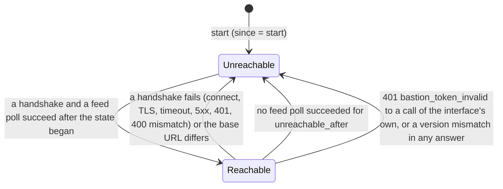

# The Quader Bastion: contracts

Status: the contracts of phase 5b are laid (the shared types, interfaces, schema, routes, configuration and the skeleton of the
role) and the role is built: package 1 (registrations and the `bst` token), package 2 ([the main installation's
interface](#package-2-the-main-installations-interface)), package 3 ([marking, the write probe and the read
shape](#marking-the-write-probe-and-the-read-shape-package-3)), package 4 ([the link to the main installation](#the-link-to-the-main-installation-package-4a),
[the engine](#the-engine-package-4b) and [how the role is wired](#how-the-role-is-wired-package-4c)), package 5 ([the cache backends](#the-cache-backends-package-5)),
package 6 ([shared state and guard](#shared-state-and-the-guard)), package 7 (the alert rules' metric inputs,
[_rules.tpl](../../deploy/helm/quader-bastion/templates/_rules.tpl)) and package 8 (the screen, client setup and the manual); the end-to-end suite of R-BAS-049 on kind
is described in [e2e.md](e2e.md#the-bastion-tests), the client case of R-BAS-060 in [the set oci](e2e.md#the-bastion-case-of-the-set-oci). The specification is
[spec/bastion.md](../spec/bastion.md) (R-BAS-001 to R-BAS-049, decisions Q-BAS-1 onward), its security perspective [security/bastion.md](../security/bastion.md), the plan
[projektplan/BETA.md](../projektplan/BETA.md#phase-5b--quader-bastion-m13).

The Bastion is a role of the one image, `quader serve --role bastion`, with a configuration tree of its own, no PostgreSQL, no UI and a
client listener that mirrors the main installation's package URL space. This page is for the eight developers who build it in
parallel: it says which package owns which file, which seams join them, how a request travels, and how to run the role.

## What to have in your head first

- **Two sides, one wire.** The Bastion's code is [internal/bastion/](../../internal/bastion); the main installation's side is
  [internal/bastionmain](../../internal/bastionmain) (seams), [internal/api/v1](../../internal/api/v1) (the operations) and the chain stage.
  The wire contract both import is [internal/bastion/iface](../../internal/bastion/iface); it changes only with `InterfaceVersion`
  ([the guard](#the-interface-guard)).
- **The Bastion's code imports no subsystem of the main installation, and the role enables none.** An allow-list rule of the archtest
  ([bastion.go](../../internal/archtest/bastion.go), R-BAS-001) holds `internal/bastion/**` to the platform packages; `internal/cluster` (the
  Valkey client) is allowed for `shared` only and `internal/blob/s3` for `cache` only. The rule is transitive
  ([Q-BAS-129](../spec/bastion.md#q-bas-129--the-import-rule-follows-the-dependency-closure-and-lists-what-it-cannot-narrow)), and what
  is true of the closure is: `go list -deps ./internal/bastion/server` also holds `internal/meta`, `meta/postgres`, `meta/postgres/q`,
  `backup/tables`, `formats/catalog` (through `internal/cluster`, whose change log and locks share its package with the Valkey client),
  `internal/audit`, `auth/scope`, `ci/claims`, `ci/reason` (through `internal/httpserver`'s request context) and `internal/blob` (through
  `blob/s3`; it brings `blob/blobcrypt` again, which the cache imports itself, for `blob.Store.CopyDataKey`). They are compiled in and never started; `bastionTransitive()` lists each with its importer and reason, any other package that
  enters the closure fails the rule with the chain, and `TestR_BAS_001_TheRoleOpensNoConnectionToPostgreSQL`
  ([server](../../internal/bastion/server/nopostgres_test.go)) starts the role with a trap where PostgreSQL would be. Narrowing them means
  splitting those three platform packages ([H-473](../spec/bastion.md#h-473--the-roles-binary-contains-packages-of-the-main-installation-it-never-starts));
  when you do, delete the entries it makes unnecessary.
- **The role builds real components only.** There is no placeholder client, cache, download buffer, guard or engine, and `engine.Deps` has no
  `Stubbed`: `server.New` fails when a component cannot be built, and `engine.New` refuses a missing dependency except `Deps.Shared`: a nil one is replaced by the local form (`shared.NewLocal`, one replica's worth), which is what the engine tests rely on; `server.New` always passes the real one. The operations of the
  management API are built; no `501 bastion_not_implemented` stub is left.
- **Every file has one owner.** The tables below name it. Shared files carry `>>> package n` markers
  ([wire_bastion.go](../../internal/app/wire_bastion.go)); edit your block only.
- **Tests carry the requirement ID** in their name (`TestR_BAS_0nn_<What>`), or in a comment for a contract or refusal test.

## Work packages and what they own

| # | Package | Owns (new files unless said) | Fills the seams |
|---|---|---|---|
| 1 | Registrations and the `bst` token type (R-BAS-004, R-BAS-005) — **built** | [bastion_registrations_api.go](../../internal/api/v1/bastion_registrations_api.go), [registrations.go](../../internal/bastionmain/registrations.go), [admin_bastion.go](../../cmd/quader/admin_bastion.go), [bastion.go](../../internal/auth/token/bastion.go) (issuance, revocation and validation of the type `bst`), [events_bastion.go](../../internal/audit/events_bastion.go); see [identity.md](identity.md#bastion-registrations-and-tokens-r-bas-004-r-bas-005) | `bastionmain.TokenAuthenticator` ([authenticator.go](../../internal/bastionmain/authenticator.go), built by `bastionAuthenticator` in the `package 1` block of `wire_bastion.go`) |
| 2 | Interface handlers, recognition (R-BAS-008 to R-BAS-012, R-BAS-015 to R-BAS-017) | [bastion_handshake_api.go](../../internal/api/v1/bastion_handshake_api.go), [bastion_check_api.go](../../internal/api/v1/bastion_check_api.go), [bastion_feed_api.go](../../internal/api/v1/bastion_feed_api.go), [bastion_downloads_api.go](../../internal/api/v1/bastion_downloads_api.go), the Recognize stage, the feed mapping over [bastion_feed.sql](../../internal/meta/postgres/queries/bastion_feed.sql), the contact upsert | `Stages.Recognize`; uses `ShapeResolver` |
| 3 | Marking and the write probe (R-BAS-013, R-BAS-014) | **built**: [internal/api/bastionmark](../../internal/api/bastionmark) (the Mark stage and the `RouteObserver`), `authz.Engine.ReachOn` and `bastionmain.NewShapeResolver` (R-BAS-012), the notes of the lookups (`bastionmain.NoteMissing`), the calls in `internal/api/rawfiles`, kit check 12 | `Stages.Mark`, `RouteObserver`, `ShapeResolver` |
| 4a | The link to the main installation, its lifecycle and the download buffer (R-BAS-006, R-BAS-010, R-BAS-025 to R-BAS-028, R-BAS-039, R-BAS-042 to R-BAS-044) — **built** | [mainclient](../../internal/bastion/mainclient) (client, budget, token reload), [link](../../internal/bastion/link), [downloads](../../internal/bastion/downloads), [server](../../internal/bastion/server), [maintest](../../internal/bastion/maintest) | `mainclient.Client`, `mainclient.Budget`, `downloads.Buffer`, `Deps.Link` |
| 4b | The engine (R-BAS-018 to R-BAS-024, R-BAS-029) — **built** | [internal/bastion/engine](../../internal/bastion/engine) | `engine.Engine` |
| 4c | The integration of 4a, 4b, 5 and 6 into one role, and the end-to-end suite (R-BAS-043, R-BAS-048) — **built** | [server](../../internal/bastion/server) (the wiring), [roletest](../../internal/bastion/roletest), the engine's use of the cache, the guard and the link | none |
| 5 | Cache backends, eviction, integrity (R-BAS-030 to R-BAS-032) — **built** | the two backends, `Cache`, `Fill`, the sweep in `internal/bastion/cache/…` | `cache.Backend`, `cache.Cache` |
| 6 | Valkey, rate limits, failed-auth timeout, blocking (R-BAS-034 to R-BAS-037) — **built** | the Valkey implementation of `shared.*` in `internal/bastion/shared/…`, `guard.New` and its `Instance`, the Valkey mechanism in `internal/cluster/valkey_bastion.go` | `shared.State`, `guard.Guard` |
| 7 | Metrics' consumers (R-BAS-040) | the PrometheusRule's metric inputs (the names are defined); the download buffer went to 4a | none |
| 8 | UI, client setup, manual (R-BAS-007) | the Bastions screen ([web-ui.md](web-ui.md#the-bastions-screen)), the `bastion=` parameter of `getClientSetup` ([packages_api.go](../../internal/api/v1/packages_api.go), [packages.md](packages.md#client-setup)), the **Install from** step of the setup page and the guides, [docs/manual/admin/bastion.md](../manual/admin/bastion.md) (built) | none; reads `BastionGet` and `BastionLastBaseURL` through `PackageServices.Bastions` |

The contract work (this page's author) owns [internal/bastion/iface](../../internal/bastion/iface), the schema, the OpenAPI document,
the configuration trees and the skeleton. A change to one of those in a work package is a contract change: say so in the review.

**Every format (packages A to D built).** The owner decided on 2026-11-22 that a Bastion serves every format as the main
installation does; the specification is [Every format](../spec/bastion.md#every-format) (R-BAS-050 to R-BAS-060). Its four work packages,
with the directories each owns and what each needs verified with a real client before it lands:

| # | Package | Owns | Depends on | Verified before landing |
|---|---|---|---|---|
| A | The two contracts and kit check 19 (R-BAS-057's wire, R-BAS-058) — **built** | `internal/formats` (`catalog.Facts.Bastion`, `contract.txt`, ADR-238), `internal/formats/formattest` (check 19, four `testformat` defects), the facts of `internal/formats/oci` and `internal/formats/clamav`, every format's fixture where check 19 needs a case; `internal/bastion/iface` (version 4: the handshake's `formats` and `boundRepository`, `Quader-Bastion-Counted`, the registry token's syntax and the unverified reading of its principal kind, `interface.txt`); [formats.md](formats.md) | none | the kit over every format (`go test ./internal/formats/...`), the interface guard |
| B | The main installation's side (R-BAS-051's main side, R-BAS-052's shape cap and check, R-BAS-055's feed, R-BAS-057's handshake, R-BAS-059's marking) — **built** ([below](#what-package-b-left-for-c)) | `internal/bastionmain` (the backstop admits `/v2/`, the feed mappings), `internal/api/bastionmark` (the shape cap, `insufficient_scope`, the counted marking, the write refusal's image prefix), `internal/api/v1` (`bastion_check_api.go` below `/v2/`, the handshake's table), `internal/api/registry` (the token service and the catalog tell the marking their kind), `internal/formathost` (the counted note), the `package 2` and `package 3` blocks of `wire_bastion.go`; the main side's sections of this page | A | the unit tests of its packages; no client reaches the main side through a Bastion before C |
| C | The Bastion's side (R-BAS-050 to R-BAS-054, R-BAS-056, R-BAS-059's reporting) — **built** ([The engine's side of every format](#the-engines-side-of-every-format)) | `internal/bastion/engine`, `internal/bastion/link` (the table), `internal/bastion/maintest`, `internal/bastion/roletest`, the `bastion` section of `internal/config` (`fill_wait_max`), `deploy/helm/quader-bastion` (the value and its schema), `test/integration/bastion`; the engine's sections of this page | A; its integration tests also B | `docker login`, `docker pull` cold and warm, `podman pull`, `crictl pull` through a Bastion run locally against the local stack; `apt-get update` and `apt-get install` in Debian 13 and Ubuntu 24.04; `ansible-galaxy collection install`; `freshclam` 1.5.5 once; the numbers written on this page |
| D | The client case on kind, the manual (R-BAS-060) — **built** ([The Bastion case of the set oci](e2e.md#the-bastion-case-of-the-set-oci)) | `test/e2e` (`TestOCI_R_BAS_051_ThroughABastion` in the set `oci`), `deploy/dev` (a Bastion release for the leg, the main installation's values for its host), [e2e.md](e2e.md), the manual pages that say a Bastion serves no Debian or images: [manual/admin/bastion.md](../manual/admin/bastion.md) (what a Bastion is), [manual/admin/apt-repositories.md](../manual/admin/apt-repositories.md) (endpoints and the Bastion), [manual/user/apt-packages.md](../manual/user/apt-packages.md) (the same), [manual/user/client-setup.md](../manual/user/client-setup.md) (install through a Bastion) | B, C | the e2e case green on the kind cluster |

B and C run in parallel after A, in disjoint directories; C's integration tests in `test/integration/bastion` need B on the same
commit, so C lands after B. The manual is changed by D and not before, because it describes what a running installation does.

**The handover per blob (the wire and the main installation's side for plain copies built, the Bastion's side not).** The owner's decision
12 (b) of 2026-11-22, a link and the data key per released blob, so that a Bastion reads large files from the main installation's object
store itself ([The handover per blob](../spec/bastion.md#the-handover-per-blob), R-BAS-070 to R-BAS-079). Its five packages, what each owns
and after which package of the signed links, several connections and the encryption each starts, are on
[bastion-handover.md](bastion-handover.md); it raised the interface to version 6. On the main installation, the registration's member
`handover` ([registrations.go](../../internal/bastionmain/registrations.go)) and the replica's snapshot of it
([handover.go](../../internal/bastionmain/handover.go)) decide with the recognition's offer (`Recognition.Offer`, read and taken out of the
request by the Recognize stage) whether the serve point may hand a forward over; the decision is
[downloadlinks/handover.go](../../internal/downloadlinks/handover.go)'s, the value reaches the marking through `bastionmain.NoteHandover`,
and the marking stage writes the class `handover` and `Quader-Bastion-Handover` ([mark.go](../../internal/api/bastionmark/mark.go)).

**Read shapes per package (built).** The development agent's decision of 2026-11-22 on Q-BAS-167, option (b): a registry token
and every reader narrowed by package can be `full` on one package, so a warm image pull costs the main installation its token request and one
check instead of a request per manifest and blob ([Read shapes per package](../spec/bastion.md#read-shapes-per-package), R-BAS-080 to
R-BAS-088). Its four packages, what each owns and their order are on [bastion-package-shapes.md](bastion-package-shapes.md); it raises the
interface to version 5, before the handover.

What package A left for B and C (the interface is at version 4; B fills the handshake's table and the counted marking, C reads them; a
main installation that sends `"formats": []` gives the Bastion an empty table, which serves nothing below `/v2/` and gives every format the
defaults):

| Piece | Where | Who uses it |
|---|---|---|
| `iface.Handshake.Formats` (`iface.HandshakeFormats`, entries `iface.HandshakeFormat{ID, RegistryRoot, ReplayHeaders, RateLimitedStatus, RetryAfterMaxSeconds, BoundPrefixes}`, `HandshakeFormat.CapRetryAfter`) and `Handshake.BoundRepository` (omitted when empty); `HandshakeFormats.Lookup` (the defaults for a format the table does not name: no replay headers, 429, the true wait), `RegistryRoot`, `Validate` | [iface/wire.go](../../internal/bastion/iface/wire.go) | B fills one entry per format of `formats.List()` with routes from `catalog.Facts`: `Bastion.ReplayHeaders`, `Bastion.RateLimited()`, `Bastion.RetryAfterMax` in seconds (interface version 7, R-BAS-091), `RegistryRoot`, `BoundPrefixes()`, empty slices rather than nil; C keeps the table on the link (`link.State.Formats`, `BoundRepository`) and validates it (built) |
| `Marking.Counted`, written as `Quader-Bastion-Counted: download` by `Marking.Set` and read by `ParseMarking` | [iface/marking.go](../../internal/bastion/iface/marking.go) | B sets it from the item store's download note; C records it on the entry (`cache.Entry.Counted`, built) |
| `RegistryTokenPrefix`, `MaxRegistryTokenBytes`, `RegistryTokenWellFormed`, `RegistryTokenAnonymous` | [iface/regtoken.go](../../internal/bastion/iface/regtoken.go) | C's credential step below `/v2/` (Q-BAS-185; built, `parseCredential`) |
| `catalog.RepresentationHeaders()` (what a cached answer replays besides the format's declared headers) and `catalog.PerRequestHeaders()` | [catalog/bastion.go](../../internal/formats/catalog/bastion.go) | C's `keepHeader`, `representationHeaders`, `perRequestHeaders` and `neverReplayed` follow them, held by `TestR_BAS_053_TheEnginesHeaderListsAreTheCatalogs`; a hit carries the three content headers of R-ARCH-007 (gap H-1250 closed by C) |
| The OpenAPI schema `BastionHandshake` with `formats` (required) and `boundRepository`, `BastionHandshakeFormat`, `x-quader-bastion-interface: 4` | [api/openapi.yaml](../../api/openapi.yaml) | B's handshake answers it |

### What package B left for C

What the Bastion meets on the wire from a main installation of this release; no interface member changed (version 4).

| Behaviour | Where | What C does with it |
|---|---|---|
| A forward of `/v2` and `/v2/…` (the repository routes, `_token`, `_catalog`) is admitted like `/api/<format>/…` and `/files/…`; any other family still answers `404 not_found` as problem details | `forwardablePath` in [recognize.go](../../internal/bastionmain/recognize.go) | forwards the registry root to `bastion.main.packages_url` |
| The probe of `POST /v2/_token` answers `204` with `Quader-Bastion-Route: read-with-body`, its form unread; the real `POST` with the form is served. A probe of a method the token service or the catalog does not answer (`PUT /v2/_token`, `POST /v2/_catalog`) answers that route's `405`, not `204` (Q-BAS-189) | `tellRoute` in [registry/bastion.go](../../internal/api/registry/bastion.go) | the probe flow of R-BAS-014, unchanged |
| A token answer (`GET` or `POST /v2/_token`) is `pass` and its `Quader-Bastion-Subject` names the Quader token the token service accepted (`token=<id>; principal=<id>; expires=<s>`), `invalid` on its `401`, `anonymous` for an anonymous token request; the catalog is `pass` with the chain's caller (Q-BAS-187) | `bastionmark.NoteCaller` in [mark.go](../../internal/api/bastionmark/mark.go) | keeps nothing of the answer (R-BAS-051); the subject is a true statement about the credential of the request |
| The probe of a write below `/v2/` answers `403` `DENIED` in the distribution's shape: `This is a read-only Bastion of https://quader.example.com; publish to quader.example.com/web/docker-local` | `readOnly` in [mark.go](../../internal/api/bastionmark/mark.go) | replays and keeps it as every probe refusal |
| A registry token's `Quader-Bastion-Read` is never `full` (an anonymous registry token's neither), and its subject is the token it was issued for with the registry token's expiry; the check answers the same (`partial` at most, `expiresAt` the registry token's) | `bastionmain.CapRegistryShape`, [bastion_check_api.go](../../internal/api/v1/bastion_check_api.go) | serves a registry token per URL after a conditional request (R-BAS-022) |
| The check of a credential with the prefix `qdr_rgt_` is answered as the stage verifies a registry token below `/v2/`; a wrongly signed or expired one is `invalid` | `bastionRegistryCheckPath`, `bastionCheckStage` in [wire_bastion.go](../../internal/app/wire_bastion.go) | sends registry tokens to the check like every credential |
| A `401` whose `WWW-Authenticate` says `error="insufficient_scope"` carries the accepted subject, not `invalid` | `insufficientScope` in [mark.go](../../internal/api/bastionmark/mark.go) | counts no failed authentication and keeps no `invalid` answer for it |
| `Quader-Bastion-Counted: download` on a `200` whose serve counts a download: every item-store serve (every format's artifacts and documents: npm's tarballs, NuGet's packages, OCI's blobs and manifests, Debian's pool and index files, Galaxy's collections, the ClamAV containers; local, remote hit and virtual), the remote engine's artifact answer (a remote's first fill), `/files/`, and `ItemStore.RecordDownload` (a remote OCI tag's manifest, recorded before its status line); never on `304`, `HEAD` or `206`. Every call of `items.Store.Served`, the one place the main installation counts, is preceded by the note. Also on a miss the engine passes through during an object-store outage, which is not counted (H-1290) | `bastionmain.CountingWriter`, `NoteCounted` in [ingest.go](../../internal/formathost/ingest.go) (`Serve`, `RecordDownload`), [remote.go](../../internal/formathost/remote.go), [rawfiles/handler.go](../../internal/api/rawfiles/handler.go), `recordTagFetch` in [remote_handlers.go](../../internal/formats/oci/remote_handlers.go) | records it on the entry and reports every serve of it (R-BAS-059) |
| The handshake's `formats`: one entry per format with routes, in the order of the IDs (`ansible`, `clamav`, `deb`, `npm`, `nuget`, `oci` today), the lists `[]` and never `null`; OCI's four headers and `["/v2/"]`, ClamAV's `503`; `"formats": []` on a replica without the table. `boundRepository` only for a binding the match of `/v2/` honours (an existing repository of the registry root's format, Q-BAS-188), left out otherwise | `BastionFormatTable`, [bastion_handshake_api.go](../../internal/api/v1/bastion_handshake_api.go) | keeps the table on the link, validates it, classifies bound paths |
| The feed carries `content` entries for `oci.manifest.deleted`, the four `deb.*` events and `ansible.version.deleted`, with the repository and its virtual repositories; `ansible.tombstone.cleared` yields none | `mappers` in [feed.go](../../internal/bastionmain/feed.go) | drops the URL answers of those repositories, as for `package.deleted` |
| *Found by C's integration test and fixed with C:* the re-derivation of a recognized Bastion request (the egress in `bastions.trusted_proxies`) sets the binding of the host of the response base URL it resolved to, the Bastion's, on the default endpoint without a host set, where the resolver binds by the request's own host, the main installation's. Without it neither a forward below `/v2/` nor the handshake saw a binding of the Bastion's host | `bastionForwarded` in [wire_bastion.go](../../internal/app/wire_bastion.go) | classifies bound paths by `boundRepository` (`TestR_BAS_057_ABoundHostThroughABastion`) |

## Package 2: the main installation's interface

Requests of a Bastion meet these pieces in this order: the Recognize stage in the chain of the default endpoint
([recognize.go](../../internal/bastionmain/recognize.go): forward or interface call, token with the throttle, version, the route-family
backstop, the re-derivation of the forwarded headers, `Recognition`), the authentication function (`v1.BastionRouteAuth` admits an
interface call as the registration and a write probe as the anonymous caller for routing only, every other request is the stage's), the
shared authorization step (`{bastion: true}`), then the handler. The four handlers are thin over the services of `v1.BastionServices`.

What the Recognize stage decides, in order (Q-BAS-115, Q-BAS-116):

1. **Forward or interface call.** `Quader-Bastion-Authorization` present: a forward, on every path, with the token of that header. Absent:
   an interface call when `routingSegments(r.URL.EscapedPath())` - the path split and decoded segment by segment, as `net/http.ServeMux`
   matches - starts with `api`, `v1`, `bastion`; the token is then the one of `Authorization`. Any other credential: an ordinary request.
2. **Token.** `TokenAuthenticator.Authenticate(ctx, raw, AuthRequest)` with the throttle of the sending address and its source
   (`RecognizeOptions.Throttle`, `.Source`, both from stage 5's resolution with `server.trusted_proxies`). The token service asks the
   throttle only after a cache miss; `ErrThrottled` is `429`, `ErrTokenInvalid` `401` and a count against the address.
3. **Version**, then the **backstop**: a forward outside `forwardablePath` (`/files/…`, `/api/<x>/…` with `<x>` not `v1`, `/v2` and
   `/v2/…`) is `404 not_found`.
4. **Re-derivation**: `RecognizeOptions.Forwarded` (the composition root's `bastionForwarded`) resolves the request again with
   `bastions.trusted_proxies` trusted when stage 5's client address is one of them, and replaces the request information
   (`httpserver.WithResolved`) and the request log's address.

| File | Responsibility |
|---|---|
| [bastionmain/recognize.go](../../internal/bastionmain/recognize.go) | `Recognize`, `RecognizeOptions`, `Throttle`, the interface metrics, the removal of the Bastion token from the request behind it; the offer of a handover per blob read into `Recognition.Offer` and `Quader-Bastion-Handover` taken out of every request (R-BAS-073) |
| [bastionmain/feed.go](../../internal/bastionmain/feed.go) | `Feed` (`Read`, `Position`; a cursor older than `system_state` `restored_at` answers reset, because the replay of a restore writes no audit event, `mustReset`, and the position of a handshake or a reset is the database clock then, `Feed.now`), `mapEvent`: the table of R-BAS-015 (`mappers`, one function per action) (`repository.narrowed` yields `content` for its repository and the virtual ones above it; `repository.claims_changed` goes through `claimsEntries`: a `global` claim among the added ones yields `grants`, claims of scope `members` yield `content`, a change that only removed or narrowed claims none, Q-BAS-146), `noFeedEntry`: the journaled events without an entry and why, the cursor, the resets |
| [bastionmain/contact.go](../../internal/bastionmain/contact.go) | `Contacts.Record`: the contact upsert, the memory gate, the cap of 256 rows, `bastion.contact`; `Release` |
| [bastionmain/downloads.go](../../internal/bastionmain/downloads.go) | `Intake.Accept`: the budget of the registration (`EventBudget`; the composition root charges units of 100 events), `artifact.downloaded` per event, `bastion.downloads.dropped` |
| [bastionmain/handover.go](../../internal/bastionmain/handover.go) | `HandoverSwitches`: the replica's snapshot of the registrations whose handover per blob is on (the change area `bastion_handover`, a minute's safety reload, the link checks asked again when one turns on); the replay of `bastion.handover.disabled` (R-BAS-071) |
| [api/v1/bastion_services.go](../../internal/api/v1/bastion_services.go) | `BastionServices` (with `Formats`, `BoundRepository`, `Handover` (the snapshot the handshake reads) and the feed as `BastionFeedSource`, which `*bastionmain.Feed` implements), `writeInterface`, `BastionPrincipal`, `BastionRouteAuth` |
| [api/v1/bastion_handshake_api.go](../../internal/api/v1/bastion_handshake_api.go), [bastion_check_api.go](../../internal/api/v1/bastion_check_api.go), [bastion_feed_api.go](../../internal/api/v1/bastion_feed_api.go), [bastion_downloads_api.go](../../internal/api/v1/bastion_downloads_api.go) | the four operations; `BastionFormatTable` builds the handshake's format table (R-BAS-057); the check presents a registry token on `/v2/bastion-check` and caps its shapes (R-BAS-052), and answers its pairs per package in request order (`checkPackages`, R-BAS-083) |
| [app/wire_bastion.go](../../internal/app/wire_bastion.go) (the `package 2` block) | the Recognize stage, `bastionForwarded` (the re-derivation over `bastions.trusted_proxies`), `bastionEventBudget` (the limiter `bastion.download_events`), `bastionServices` (the table of `formats.List()`, `bastionBoundRepository` = the dispatcher's `BoundRepository`), `bastionCheckStage` (the default endpoint's stage with every family served, Q-BAS-190), the metrics, the throttle; `bastionTokens` and `bastionShapes` are the two accessors packages 1 and 3 fill |
| [audit/events_bastion_iface.go](../../internal/audit/events_bastion_iface.go) | `bastion.contact`, `bastion.downloads.dropped` |
| [meta/postgres/queries/bastion_feed_names.sql](../../internal/meta/postgres/queries/bastion_feed_names.sql), [bastion_contact_cap.sql](../../internal/meta/postgres/queries/bastion_contact_cap.sql) | the two statements package 2 added to the contract's files |

Things other code now relies on: `httpserver.Credential.ExpiresAt` (the marking's `expires=` and the check's `expiresAt`), `httpserver.KindBastion`,
`httpserver.WithClient` (the check runs a credential for the caller's address), `httpserver.WithResolved` (the re-derivation),
`audit.Event.At`, `auth.NewAddressThrottle`, `postgres.IsNoRows`, `cluster.Limiter.TakeNAt` (a request charged n units, n `INCR` in one transaction, at most `MaxTakeUnits`), and
`App.credentialStage`, which records nothing in the request log: `App.authenticate` does, so the check leaves the line of the registration
alone (Q-BAS-119). The kind `bastion` has an empty principal set in the decision point (`authz.kindBastion`). Recognition is also where the main installation's own hot path can be slowed by a Bastion: it adds a header lookup to every
request of the default endpoint and a store lookup only for a value that starts with `qdr_bst_`.

To replace a seam: `App.bastionTokens` returns package 1's `TokenAuthenticator` (without one, every Bastion token is invalid), `App.bastionShapes`
returns package 3's `ShapeResolver` (without one, the check answers `503`).

## Package tree

```text
internal/bastion/
├── iface/            the wire contract of both sides; stdlib only; guarded by testdata/interface.txt
├── answers/          the validity rules of R-BAS-020 and the feed log; a leaf
├── metrics/          every metric of R-BAS-040, defined once; a leaf
├── mainclient/       the client of the main installation: HTTPClient, SlotBudget, Reloader, TokenSource, errors; token file and holder
├── link/             the replica's standing connection: handshake, feed poll, reachable or not, mismatch, token lifetime; Guard wraps the client
├── handover/         the link client of a handover per blob and the readers of a plain and an encrypted copy (R-BAS-074); imports blobcrypt
├── cache/            Backend, Entry, the HMAC Signer; the volume and bucket backends, Cache, Fill, the sweep, Fault (a test's switch)
├── shared/           the shared state (limiters, block list, timeouts, flight lock, sweep lease, answer records): the local form and the Valkey form
├── guard/            Guard (R-BAS-035 to R-BAS-037): Instance, the verdicts, and the address key (an IPv6 address counts as its /64)
├── downloads/        Buffer of download events and its Reporter (R-BAS-039)
├── engine/           Deps, Engine: the request flow of R-BAS-018 to R-BAS-029
├── server/           the process of the role: telemetry, token, TLS, listeners, health, the wiring of every component, drain
├── maintest/         an in-process main installation (httptest TLS), an object store for the handover, doubles for the tests of the Bastion; a test helper
└── roletest/         the end-to-end scenario of the whole role in one process (R-BAS-048); a test helper
internal/bastionmain/ the main installation's seams (a domain package)
```

<details>
<summary>File → responsibility</summary>

| File | Responsibility |
|---|---|
| [iface/version.go](../../internal/bastion/iface/version.go) | `InterfaceVersion` |
| [iface/routes.go](../../internal/bastion/iface/routes.go) | the four route paths, the feed query parameters, the operation names, the mirrored path families |
| [iface/headers.go](../../internal/bastion/iface/headers.go) | every header name of R-BAS-008, R-BAS-013, R-BAS-014, R-BAS-017, R-BAS-059 (`Quader-Bastion-Counted`), R-BAS-082 (`Quader-Bastion-Package`, `Quader-Bastion-Package-Read`) and R-BAS-073 (`Quader-Bastion-Handover`), the probe, route and counted values, the token prefix |
| [iface/marking.go](../../internal/bastion/iface/marking.go) | `Class`, `Read`, `Marking` (Set, Parse, Strip; `Counted`; `Package` and `PackageRead` with the five refusals of R-BAS-082 in `parsePackage`), `SubjectKind`, `Subject` and its header form |
| [iface/package.go](../../internal/bastion/iface/package.go) | the package names of the interface: `ValidPackage`, `MaxPackageBytes` (512) and the strict percent-encoding of `Quader-Bastion-Package` (R-BAS-082) |
| [iface/cursor.go](../../internal/bastion/iface/cursor.go) | `Cursor` and the synthetic `t:<RFC 3339>` form |
| [iface/wire.go](../../internal/bastion/iface/wire.go) | the bodies of the handshake (with the format table `HandshakeFormats` and `BoundRepository`, R-BAS-057), check (with `packages` in request and answer, always written, and the request's rules `CheckRequest.PackagesProblem`, R-BAS-083), feed and downloads, `FeedKind`, `DecodeStrict`, `Marshal` |
| [iface/regtoken.go](../../internal/bastion/iface/regtoken.go) | the registry token's form below `/v2/` and the unverified reading of its claims: the anonymous claim (R-BAS-052, Q-BAS-185), the grant (`RegistryTokenGrant`, `RegistryGrant.Pulls`, Q-BAS-246) and the expiry (`RegistryTokenExpiry`, Q-BAS-252) |
| [iface/handover.go](../../internal/bastion/iface/handover.go) | the handover per blob (R-BAS-072, R-BAS-073): the offer `HandoverOffer`, the value `Handover` with `EncodeHandover`, `DecodeHandover` and `Check`, the data key `HandoverKey` that renders `[REDACTED]`, `ETagContentAddress`, and the copies of `S` and of the connection pattern ([Q-BAS-280](../spec/bastion.md#q-bas-280--the-wire-checks-storedsize-against-ssize-itself)) |
| [iface/problems.go](../../internal/bastion/iface/problems.go) | the problem codes of R-BAS-008, R-BAS-009, R-BAS-014 and R-BAS-029 |
| [iface/surface_test.go](../../internal/bastion/iface/surface_test.go) | the generator of the surface and the guard of R-BAS-009 |
| [answers/answers.go](../../internal/bastion/answers/answers.go) | `Answer`, `State.Check` (the four rules), `FeedLog` (Record, Prune, Reset) |
| [metrics/metrics.go](../../internal/bastion/metrics/metrics.go) | names, label values, `Metrics`, `New`, `Names` |
| [mainclient/mainclient.go](../../internal/bastion/mainclient/mainclient.go) | `Client`, `Forward`, `Response`, `Budget`, `Token`, `TokenSource`, `Options`, the errors |
| [mainclient/client.go](../../internal/bastion/mainclient/client.go), [mainclient/budget.go](../../internal/bastion/mainclient/budget.go), [mainclient/reload.go](../../internal/bastion/mainclient/reload.go) | `HTTPClient` (the four operations and the forward, TLS only, the slot held until the body ends), `SlotBudget`, `Reloader` |
| [link/link.go](../../internal/bastion/link/link.go), [link/guard.go](../../internal/bastion/link/guard.go) | `Link` (handshake, feed poll, `State`, `AnswerState`, `Watch`, `SetSink`), `Guard` (a refused token or a mismatch in any answer makes the replica unreachable) |
| [mainclient/token.go](../../internal/bastion/mainclient/token.go) | `ParseToken` (prefix, length, base62, CRC), `ReadTokenFile`, `Holder` |
| [cache/cache.go](../../internal/bastion/cache/cache.go) | the layout, `Backend`, `Entry`, `Usage` |
| [cache/fault.go](../../internal/bastion/cache/fault.go) | `Fault`: the switch with which a test makes the storage fail (`Options.Fault`); nil in production |
| [cache/sign.go](../../internal/bastion/cache/sign.go) | `Signer` (Sign, Verify, SignEntry, VerifyEntry), `KeyHash`, the signature domains |
| [cache/layout.go](../../internal/bastion/cache/layout.go) | `layout`: `plainLayout` (R-BAS-030's names) and `sealedLayout` (R-BAS-061's keyed names below the key's tree), `WithArea`, validation of every name that becomes a path or a key |
| [cache/core.go](../../internal/bastion/cache/core.go) | `backend`, the one implementation of `Backend` over a `store` and a `layout`: probe, spool, eviction sweep, audit spool, error counting; with a key it hands the writes and reads to sealed.go |
| [cache/crypt.go](../../internal/bastion/cache/crypt.go) | the cache key (R-BAS-061): `openSealer` reads the file by R-ARCH-021's rules, `sealer` (storage key, identifier, name key, keyed names, the key lookup), the record's frame in front of a body (Q-BAS-212), the binding of a plaintext to its name (Q-BAS-213), what counts as a refusal |
| [cache/sealed.go](../../internal/bastion/cache/sealed.go) | the sealed objects: writes through `blobcrypt.NewSection` and `Wrap`, reads through `Open`, `NewReader` and `NewRangeReader`, the plaintext size of a head |
| [cache/foreign.go](../../internal/bastion/cache/foreign.go) | the sweep of other layouts: the plain layout and other keys' trees, in a replica's first hour and while found (Q-BAS-215) |
| [cache/volume.go](../../internal/bastion/cache/volume.go), [cache/bucket.go](../../internal/bastion/cache/bucket.go) | the two stores: a directory, and S3 through `internal/blob/s3` |
| [cache/verify.go](../../internal/bastion/cache/verify.go), [cache/fill.go](../../internal/bastion/cache/fill.go) | the verifying reader with its hold-back, the `Fill` spool |
| [cache/store.go](../../internal/bastion/cache/store.go), [cache/sweep.go](../../internal/bastion/cache/sweep.go) | `Cache` (what the engine uses), `New`, `NewVolume`, `NewBucket`, `Options`; `SweepOnce`, `RunSweeper` |
| [shared/shared.go](../../internal/bastion/shared/shared.go) | `Limiter`, `BlockList`, `FlightLock`, `SweepLease`, `AnswerStore`, `State`, `NewLocal` |
| [shared/local.go](../../internal/bastion/shared/local.go) | the local forms: token buckets, sliding-window counters, block list, flights, answers in memory, all bounded |
| [shared/valkey.go](../../internal/bastion/shared/valkey.go) | `Open`, `New`, `Options`: the Valkey forms over `cluster.BastionStore`, the limiters of R-ARCH-034 and the FlightLock, with the local forms as the fallback; the signing of answer records |
| [guard/guard.go](../../internal/bastion/guard/guard.go) | `Guard`, `Verdict`, `AddressKey` |
| [guard/instance.go](../../internal/bastion/guard/instance.go) | `New`, `Options`, `Instance`: the limits, the miss limits, the timeout, the blocking |
| [server/shared.go](../../internal/bastion/server/shared.go) | `openShared`: builds the state and the guard from the configuration and closes them |
| [downloads/downloads.go](../../internal/bastion/downloads/downloads.go), [downloads/reporter.go](../../internal/bastion/downloads/reporter.go) | `Buffer`; `Reporter` (the bounded buffer, batches, the spool to the cache backend, the adoption of spool files) |
| [engine/engine.go](../../internal/bastion/engine/engine.go) | `Deps`, `Engine`, `New` (hands the link its `AnswerSink`), `Start` and `Drain` (the janitor and the background tasks), `Ready` (the cache's first check) |
| [engine/request.go](../../internal/bastion/engine/request.go) | `ServeHTTP`, the request record `rq`, the steps of R-BAS-018 (host, block list, path, limits, credentials), the guard's verdict as a response |
| [engine/credential.go](../../internal/bastion/engine/credential.go) | `Authorization` (Bearer, Basic), the token syntax, the credential key, the challenge |
| [engine/respond.go](../../internal/bastion/engine/respond.go) | the Bastion's own problem details, the mapping of the client's errors, the header filters |
| [engine/answerstore.go](../../internal/bastion/engine/answerstore.go) | answers in memory and in the shared store (a copy in memory that fails a rule is dropped and the shared record is read, Q-BAS-153), negative entries, private copies, the `AnswerSink` the link calls |
| [engine/readflow.go](../../internal/bastion/engine/readflow.go) | the decision between hit, check and miss, the check, the collapsing of misses |
| [engine/forward.go](../../internal/bastion/engine/forward.go) | the forwarded request, the handling of a marked response by its class, documents and refusals |
| [engine/fill.go](../../internal/bastion/engine/fill.go) | `fillRun`, the artifact fill that reads its source (the main installation's body, or a handover's direct read) into `cache.Fill` without the client, `newFillRun` and `runFill`, which both sources share, and `follow`, which serves the client from the spool with the withheld tail |
| [engine/handover.go](../../internal/bastion/engine/handover.go) | the handover per blob at the Bastion: `offerFor`, `onHandover`, `checkHandover`, `fallback`, the continuation (`continuation`, `continues`, `turnToMain`), `directFill` and its one outcome, the mark and the cooldown |
| [handover/client.go](../../internal/bastion/handover/client.go), [handover/read.go](../../internal/bastion/handover/read.go) | the link client of R-BAS-074 (`Client`, `Open`, `Error` with its `Cause`, `ErrDigest`) and the readers of a plain and of an encrypted body (`Read`) |
| [engine/serve.go](../../internal/bastion/engine/serve.go) | serving a representation with RFC 9110 semantics, the stream with the withheld tail, the download event |
| [engine/entries.go](../../internal/bastion/engine/entries.go) | the cache key and Vary, the entry through `cache.Cache`, freshness |
| [engine/probe.go](../../internal/bastion/engine/probe.go) | the write probe and the real request of a read route that takes a body |
| [engine/family.go](../../internal/bastion/engine/family.go) | the path families (`classify`, `classifyRegistry`, the bound host), the core routes of `/v2/`, the registry's challenge and the distribution's error shape of the Bastion's own answers below `/v2/` |
| [engine/registry.go](../../internal/bastion/engine/registry.go) | the core routes' flow (`versionChallenge`, `passCore`), the token service's form, the registry token's expiry, the shape cap, `insufficient_scope` |
| [engine/background.go](../../internal/bastion/engine/background.go) | the background refresh of a shape answer |
| [engine/quiet.go](../../internal/bastion/engine/quiet.go) | `WithQuietSlot`, `Quiet`: how a quiet verdict reaches the server's request log |
| [engine/lru.go](../../internal/bastion/engine/lru.go), [engine/flight.go](../../internal/bastion/engine/flight.go) | the bounded LRU, the single-flight and the `handle` of a flight that a fill takes over |
| [server/server.go](../../internal/bastion/server/server.go) | `Run`, `New`, `Start`, `Shutdown`; `buildDeps` and `wireLink` build and connect the components, `runLink` runs their loops |
| [maintest/maintest.go](../../internal/bastion/maintest/maintest.go), [maintest/store.go](../../internal/bastion/maintest/store.go) | `Main`, the in-process main installation; `Faulty`, `MemSpool`; `Store`, the TLS object store of the handover's tests |
| [roletest/roletest.go](../../internal/bastion/roletest/roletest.go) | `Run`: the scenario of the whole role for one cache backend |
| [bastionmain/recognition.go](../../internal/bastionmain/recognition.go) | `Recognition`, `WithRecognition`, `RecognitionFrom` |
| [bastionmain/auth.go](../../internal/bastionmain/auth.go) | `TokenAuthenticator`, `BastionToken`, `ErrTokenInvalid` |
| [bastionmain/shape.go](../../internal/bastionmain/shape.go) | `ShapeResolver`, `Shape`, `CapRegistryShape` (a registry token is `partial` at most, R-BAS-052) |
| [bastionmain/shape_resolver.go](../../internal/bastionmain/shape_resolver.go) | `NewShapeResolver`: the resolver over `authz.Reacher`, the status of a `none` |
| [bastionmain/absence.go](../../internal/bastionmain/absence.go) | `Absence`, `WithAbsence`, `NoteMissing`, `NoteUnknown`, `NoteCounted`, `CountingWriter`: the per-request record of what the lookups and the counting serves found; `NoteHandover` and `MarksHandover`, the value of a handover per blob for the marking (R-BAS-073) |
| [api/bastionmark/mark.go](../../internal/api/bastionmark/mark.go) | `New`, `Marker.Stage`: the Mark stage, its observer, the marking at the status line, the write refusal and the probe answer, the strip; `NoteCaller` (the token service's caller) |
| [api/registry/bastion.go](../../internal/api/registry/bastion.go) | `tellRoute`: the token service and the catalog tell the marking their kind (R-BAS-051) |
| [bastionmain/route.go](../../internal/bastionmain/route.go) | `RouteObserver`, `RouteMatch`, `RouteDecision`, `WithObserver`, `ObserverFrom`, the kind names |
| [bastionmain/stages.go](../../internal/bastionmain/stages.go) | `Stages` (Recognize, Mark, Chain), `Stub`, `ErrNotImplemented` |
| [bastionmain/metrics.go](../../internal/bastionmain/metrics.go) | `quader_bastion_interface_requests_total`, `quader_bastion_forwarded_requests_total`, `quader_bastion_forwarded_bytes_total` (R-BAS-090: `markWriter.Write` in [bastionmark](../../internal/api/bastionmark/mark.go) adds every body byte of a recognized forward under the caller's class; `fillRun.class` gives the Bastion's `quader_bastion_fill_bytes_total` the class of the request that started the fill) |

</details>

## Seams

| Seam | Declared in | Implemented by | Used by |
|---|---|---|---|
| Recognition result in the request context | [bastionmain/recognition.go](../../internal/bastionmain/recognition.go) | package 2 (the Recognize stage) | package 3, the shared authorization step ([authorize.go](../../internal/api/v1/authorize.go), built), the interface handlers (package 2) |
| `TokenAuthenticator` (raw token → enabled registration, token ID, expiry) | [bastionmain/auth.go](../../internal/bastionmain/auth.go) | package 1 (query `BastionTokenBySecret`, the token cache and revocation bound of R-AUTH-023) | package 2 |
| `ShapeResolver` (subject × repositories → full, partial, none, status) | [bastionmain/shape.go](../../internal/bastionmain/shape.go) | **package 3** (Q-BAS-51): `NewShapeResolver(engine)`, wired by `App.bastionShapes` | package 3 (marking), package 2 (check) |
| Route kind and coarse action to a middleware | `RouteObserver` in [bastionmain/route.go](../../internal/bastionmain/route.go); called by [dispatcher.go](../../internal/api/dispatch/dispatcher.go) after the match and after the decision and by [rawfiles/handler.go](../../internal/api/rawfiles/handler.go) (`routeOf`, `decided`) | package 3 ([bastionmark](../../internal/api/bastionmark/mark.go)) | package 3 |
| The chain stage | `Chain.Bastion` in [chain.go](../../internal/httpserver/chain.go) (built); `Stages` | package 2 (Recognize), package 3 (Mark), composed in [wire_bastion.go](../../internal/app/wire_bastion.go) | the default endpoint's chain only |
| The permission form `{bastion: true}` | [authorize.go](../../internal/api/v1/authorize.go) (built) | contract work | the four interface operations |
| `bst` is unknown to every other route | [token.Service.Check](../../internal/auth/token/validate.go) (built) | contract work | all |
| The token API does not see a `bst` token | `IdentityListTokens` and `IdentityTokenRow` in [identity.sql](../../internal/meta/postgres/queries/identity.sql) (built) | contract work | package 1 manages the tokens through `/bastions/{name}/tokens` and `bastion_registration.sql` |
| Last contact of a replica | [bastion_contact.sql](../../internal/meta/postgres/queries/bastion_contact.sql) | package 2 writes (`BastionContactUpsert`, `BastionContactPrune`) | package 1 reads (`BastionContactList`, `BastionContactListAll`), package 8 (`BastionLastBaseURL`) |
| Feed inputs | [bastion_feed.sql](../../internal/meta/postgres/queries/bastion_feed.sql) | contract work | package 2 |
| `mainclient.Client`, `Budget`, `TokenSource` | [mainclient.go](../../internal/bastion/mainclient/mainclient.go) | package 4a (`HTTPClient`, `SlotBudget`, `Reloader`) | the link, the buffer, the engine |
| `engine.Deps.Link` and `link.AnswerSink` | [link.go](../../internal/bastion/link/link.go) | 4a (the link); the engine implements `AnswerSink` and calls `Link.SetSink` in `engine.New` | the engine |
| `cache.Backend`, `cache.Cache` | [cache.go](../../internal/bastion/cache/cache.go), [store.go](../../internal/bastion/cache/store.go) | package 5 | the engine (`Cache`), the download buffer (`Backend()` for the spool), the server (`RunSweeper`) |
| `shared.State`, `guard.Guard` | [shared.go](../../internal/bastion/shared/shared.go), [guard.go](../../internal/bastion/guard/guard.go) | package 6 (built: [Shared state and the guard](#shared-state-and-the-guard)) | the engine, the cache sweeper (`shared.State` is its `LeaseSource`), the download buffer (the claim of a spool file) |
| `downloads.Buffer` | [downloads.go](../../internal/bastion/downloads/downloads.go) | package 4a (`Reporter`) | the engine (`Add`), the server (`Run`, `Drain`, `SetEnabled`) |
| Metrics | [metrics.go](../../internal/bastion/metrics/metrics.go) | contract work | everyone; add no metric elsewhere |
| Problem codes | [iface/problems.go](../../internal/bastion/iface/problems.go), [errs/codes.go](../../internal/errs/codes.go) | contract work | everyone |

### The interface guard

[surface_test.go](../../internal/bastion/iface/surface_test.go) lists every exported declaration of `iface` (constants with values, types
with fields and JSON tags, functions) into [testdata/interface.txt](../../internal/bastion/iface/testdata/interface.txt), the version on the
first line. `TestR_BAS_009_TheInterfaceChangesOnlyWithItsVersion` fails when the code and the file differ. To change the interface:
raise `InterfaceVersion`, then `go test ./internal/bastion/iface -run TestR_BAS_009 -update-interface`; the regeneration refuses to write
a changed surface under an unchanged version. The OpenAPI document must name the new version in `x-quader-bastion-interface`
(`LoadDocument` checks it), and the release notes announce it. The interface is at version 6 since the wire of the handover per blob
([bastion-handover.md](bastion-handover.md), package 1): `Quader-Bastion-Handover` as the offer on a forward and as the value on an answer,
the class `handover`, the handshake's `handover`, and the types `HandoverOffer`, `Handover` and `HandoverKey` with every check of R-BAS-073
in [handover.go](../../internal/bastion/iface/handover.go). Version 5 was the read shapes per package
([bastion-package-shapes.md](bastion-package-shapes.md), P1). The interface is a leaf that imports nothing of the module: where a check needs a
rule of another package (the stored format's `S`, the connection pattern), the rule is written in `iface` and an internal test holds it to its
owner ([Q-BAS-280](../spec/bastion.md#q-bas-280--the-wire-checks-storedsize-against-ssize-itself)).

## Shared state and the guard

Package 6 built both. The server makes them in [server/shared.go](../../internal/bastion/server/shared.go) from the configuration and
hands `engine.Deps.Shared` and `engine.Deps.Guard` over; it closes them (the Valkey client, the guard's gauge loop) at the end of the drain.

**What changed in the committed interfaces (a contract change, said here on purpose).** Package 4 reads this before it calls the guard.

| Where | Change | Why |
|---|---|---|
| `guard.Stub`, `guard.IsStub` | removed (and with them every other stub of the role, [below](#how-the-role-is-wired-package-4c)) | the stub is replaced (Q-BAS-94) |
| `guard.Verdict` | new field `Quiet`: the request is not to be logged one by one | a blocked address answers many requests, the guard logs one line per block (R-BAS-037); the server keeps such a request out of the request log ([how](#how-the-role-is-wired-package-4c)) |
| `shared.State` | new field `Timeouts` (a `BlockList` for the failed-authentication timeouts) | R-BAS-036 needs a timeout that outlives the counting window |
| `shared.Limiter` | `Add` and `Count` return the count **in the units of the configured value**: a local form multiplies its count by `bastion.replicas`; `Replicas()` stays but a caller need not use it | one comparison for every form (Q-BAS-92) |
| `shared.Limiter` | new `AddIfWithin(name, key, window, limit)`: counts the event only if the count with it stays within `limit` | a refused miss consumes nothing (Q-BAS-127); the miss limits use it, the failure and refusal counters keep `Add` |
| `cluster.Limiter` | new `TakeUncharged` and `EstimateWithin` ([limiter_uncharged.go](../../internal/cluster/limiter_uncharged.go)) | the Valkey forms of the same: a refusal counts itself in a counter of refusals (`<limiter>-refused`) that the estimate subtracts; no `DECR`, the Bastion's ACL has none |
| `shared.FlightLock` | on an error `held` is **true**: the replica fetches itself | the lock is an optimization (R-BAS-034) |
| `shared.SweepLease` | with Valkey unavailable the lease is held and `err` is nil | a sweep only deletes (R-BAS-031) |
| `shared.AnswerStore` | the Valkey form signs on `Put` and verifies on `Get`; the engine hands over the record and **does not sign** | Q-BAS-93; a record above 1 KiB (signature included) is refused with an error and kept in memory by the engine only |
| `cluster.WithoutKeyspace`, `cluster.BastionStore`, `cluster.FlightKeyFromHash`, `cluster.Limiter.Estimate` | new in `internal/cluster` | the typed mechanisms behind the Valkey form ([valkey.md](valkey.md#the-bastions-keys)) |

**Where the engine calls the guard** (R-BAS-018). Every method takes the address as `guard.AddressKey` returns it.

| Step | Call | A refusal |
|---|---|---|
| 2, block list | `Blocked(addr)` | `429 address_blocked`, `Quiet`, `Retry-After` |
| 4, limits | `Request(addr, credentialed)` | `429 rate_limited` |
| a credential the Bastion refuses itself (R-BAS-019) | `FailedAuth(addr)` | none, the answer is the `401` |
| before a check or a forward for a credential with no usable answer | `AuthTimeout(addr)` | `429 auth_timeout`; nothing is sent to the main installation |
| before every request to the main installation (forward, check, conditional, probe) | `Miss(addr, credentialed)` | `429 rate_limited` while hits keep being served |
| the main installation called the credential invalid | `FailedAuth(addr)` | none |

The guard decides and returns a `Verdict` (`Status`, `Code`, `RetryAfter`, `Reason`, `Quiet`); the engine renders the problem details of R-BAS-029,
sets `Retry-After` and the `RateLimit` fields, and counts `quader_bastion_refused_total{reason=Verdict.Reason}`. The guard counts the blocks it sets
(`quader_bastion_blocks_total`, `quader_bastion_blocked_addresses`) and logs `bastion address blocked` once per block. An error of the shared state
admits the request (Q-BAS-94). `exempt_cidrs` are parsed at `guard.New`; a bad entry stops the start.

**The rules in one place.**

- **A limit admits up to its rate; a refusal consumes nothing** ([Q-BAS-127](../spec/bastion.md#q-bas-127--a-refused-request-or-miss-does-not-consume-the-limit-it-was-refused-by)).
  A client at 110 % of its limit is admitted at the limit, collects refusals at a tenth of its requests, and is far below the block threshold;
  a flood of several times the limit still reaches it. This is the other reading of R-ARCH-034's window: its `Take` charges refused requests
  (right for the main installation's logins), the Bastion's `TakeUncharged` does not.
- Request limits: a token bucket without Valkey, the sliding window of the admitted requests with it (limiters `bastion.requests_authenticated`,
  `bastion.requests_anonymous`); the local rate and burst are divided by `bastion.replicas`.
- Miss limits: the count of the admitted misses of the sliding minute (limiters `bastion.misses_authenticated`, `bastion.misses_anonymous`);
  the retry delay is 15 s. The sliding estimate can admit more than the limit around a window boundary
  ([H-474](../spec/bastion.md#h-474--the-sliding-estimate-of-a-limit-admits-more-than-the-limit-in-a-minute-that-spans-a-boundary)).
- Failed authentication (`bastion.failed_auth`): the failure that brings the count of the window to `max_failures` puts the address into the timeout
  (`Timeouts`, `failed_auth.timeout`); the next credential without a usable answer is refused. Anonymous requests and credentials with a usable answer
  are not the guard's to refuse.
- Blocking (`bastion.refusals`): every refusal of a request limit, a miss limit or the timeout counts; more than `threshold` within `window` blocks the
  address for `duration`, doubled for each earlier block within 24 h, up to `max_duration`. The decision is serialized in the process **per address**
  ([keyedlock.go](../../internal/bastion/guard/keyedlock.go): a lock that exists only while somebody holds or waits for it, so the Valkey round
  trips of one address's decision hold no other address back, Q-BAS-128); across replicas two blocks can race, and the later one raises the level.
- `failed_auth.window` is 1 s to 12 h, the range of the limiters; the configuration refuses a longer one (`shared.MaxWindow` and the `max=12h` of
  [bastion_role.go](../../internal/config/bastion_role.go) are the same number, and `TestR_BAS_036_TheConfigurationAcceptsExactlyTheWindowsTheLimiterCounts` ties them).
- IPv6 counts as its /64, an IPv4-mapped address as the IPv4 address (`AddressKey`).

**The local forms** ([local.go](../../internal/bastion/shared/local.go), [lru.go](../../internal/bastion/shared/lru.go)) are what runs without
Valkey (the default) and the fallback with it. Every map is a `shardMap`: 64 shards, each with its own mutex and a list in order of use. A key that
arrives at a full shard evicts the least recently used entry of that shard in constant time, so no request scans a map and no lock is shared by all
requests (an IPv6 /47 supplies enough /64 keys to have kept every request on a 100,000-key scan under one mutex before, Q-BAS-128). The bound is 100,000
entries per map; an entry evicted while it still counts starts again, which admits at most one extra budget of its address. `memBlocks.Size` (the gauge)
visits the blocks shard by shard.

**Valkey and its absence.** `shared.Open(ctx, shared.Options{...})` returns the local state for `valkey.mode: none` and the Valkey state otherwise,
with a closer. The Valkey form runs on `cluster.NewValkey(..., cluster.WithoutKeyspace())` and keeps a memory next to every mechanism: the block list
writes to both, reads memory first (a blocked address costs no round trip) and then Valkey; the limiters are the cluster limiters whose fallback is
the replica's share; the answers are Valkey only (the engine has its own memory). A Valkey that is down, refuses the credential or is slow makes
the state run from memory and never the replica unready; `quader_valkey_available` and `quader_ratelimit_fallback{limiter}` show it. Losing Valkey
costs the sharing, not correctness. The keys are in [valkey.md](valkey.md#the-bastions-keys).

**Add a limit.** A new limiter is a name `bastion.<name>` in [guard/instance.go](../../internal/bastion/guard/instance.go), a call to
`State.Limiter.Allow` (bucket) or `Add` (count), and a row in R-BAS-035 to R-BAS-037; the name is a metric label, so it carries no address. A new
shared mechanism is a typed method in `internal/cluster/valkey_bastion.go` first, then the interface in `shared.go`, its local form in `local.go` and its
Valkey form in `valkey.go`.

## Request flows

**Hit** (R-BAS-022): the engine classifies the request (host, block list, path, limits, credential), finds the cache entry for the
cache key, finds a usable `full` read-shape answer for the caller (or a usable URL answer) and the entry fresh, and serves the bytes
from the cache through its verifying reader. It adds a `DownloadEvent` to `downloads.Buffer`. No request to the main
installation.

**Check** (R-BAS-011, R-BAS-022): the entry exists and the caller has no usable answer. The engine takes a budget slot and sends one
`Check` for the credential and the repository (collapsed per credential and repository); on `full` it serves as a hit. For a `partial`
caller it sends a conditional `Do` with the caller's credential and `If-None-Match: "<sha256>"` through the real route: `304` serves the
cached bytes. The main installation's `check` handler validates the credential (throttle, `token.rejected`) and asks the
`ShapeResolver`.

**Miss** (R-BAS-021): the engine takes a budget slot, forwards the request with the caller's `Authorization`, the Bastion token in
`Quader-Bastion-Authorization` and the forwarded-for and host headers. On the main installation: the Recognize stage validates the token
and stores a `Recognition`; the Mark stage installs the observer; authentication and the dispatcher decide as for the caller's own
request; the marking wrapper adds `Quader-Bastion-Class`, `-Repository`, `-Read`, `-Subject` and `-Interface` at the status line. The
engine keeps what the class allows, streams the rest.

**Write probe** (R-BAS-014): a method other than `GET` and `HEAD` becomes a bodiless `Do` with `Probe` set, no credential and
`Quader-Bastion-Probe: 1`. The dispatcher calls `RouteObserver.Matched` after the match: for an `Upload`, `Delete`, `Admin` route or a
coarse action other than `read` it returns the `bastion_read_only` error, which the format renders in its own shape; for a read route
that takes a body it answers `204` with `Quader-Bastion-Route: read-with-body` and reports `handled`. The Bastion replays a `403` or
`404` and, after a `204`, forwards the real request.

**One cache, several replicas.** An entry kept under a key that carries the values of the request headers named by `Vary` is also written
under the key without them ([entries.go](../../internal/bastion/engine/entries.go) `saveEntry`), and a replica that has not learned the
target's `Vary` reads the names from that entry (`learnVaryFromCache`). The names are learned per replica, so without the second entry a
replica of the bucket backend would not find a document its peer kept and would ask the main installation again. The plain-key entry is a
pointer to the names, never served for a request of a target with names. A partial reader's `304` to the validator of the shared entry is
not its answer (`onPrivate`): the request is repeated without a validator.


## The link to the main installation (package 4a)

The Bastion reaches the main installation through one client, one standing link per replica and one download buffer. The server builds and runs
all three; the engine reads them.

### What the server runs

| Loop | Package | Started by | Stopped |
|---|---|---|---|
| The link: handshake, feed poll, state | [link](../../internal/bastion/link) `Link.Run` | `server.runLink` after the listeners are bound | after the buffer was drained |
| The token reloader | [mainclient](../../internal/bastion/mainclient) `Reloader.Run` | `server.runLink` | with the link |
| The buffer's flush and spool adoption | [downloads](../../internal/bastion/downloads) `Reporter.Run` | `server.runLink` | before the drain, so that `Drain` sends what is left |
| The cache sweeper | [cache](../../internal/bastion/cache) `Cache.RunSweeper` with `shared.State` as its `LeaseSource` | `server.runLink` | before the drain |

`Engine.Start` starts none of them (it runs the janitor, [below](#the-engine-package-4b)). Readiness is the start-up check, the TLS material and the cache
backend's first `Check`; it never depends on the main installation (Q-BAS-44).

### What the engine gets in `engine.Deps`

| Field | What it is | What the engine does with it |
|---|---|---|
| `Main` | the `mainclient.Client`, wrapped by `Link.Guard` | `Handshake` and `Feed` are the link's; the engine calls `Check`, `Do` and nothing else. Every call but those two takes a budget slot inside the client |
| `Link` | the `*link.Link` | reads the state (below), `Feed()` for the log, sets the sink once |
| `Downloads` | the `downloads.Buffer` | `Add` for every artifact served from the cache (a hit, or a check answered `304`); `SetEnabled` is the server's |
| `Handover` | the `*handover.Client`, the link client of the handover per blob, built by the server with `bastion.main.ca_file`, the two timeouts and the hosts it refuses | `Open` for an answer of the class `handover` ([below](#the-handover-per-blob-at-the-bastion)); nil offers no handover |

**The client's contract.**

- `Do(ctx, Forward)` sends the caller's request (method, path and query as received; the caller's `Authorization` and end-to-end
  headers), removes `Cookie`, `Forwarded`, `X-Forwarded-*`, `Quader-*`, `Range`, `If-*`, trace headers and the hop-by-hop headers,
  and adds the interface headers, the Bastion token in `Quader-Bastion-Authorization` and exactly one client address from
  `Forward.ClientAddress` in both families. `IfNoneMatch` is the Bastion's own condition. `Probe` sends the method without a body
  and without the caller's credential. A redirect is returned, not followed. `Offer` is the engine's offer to take a handover
  (R-BAS-072) and `RangeFrom` with `IfRange` its continuation of a fill (R-BAS-075), all three set after the copy of the caller's headers.
- An answer of the class `handover` is taken only from a forward that offered: `Response.Handover` holds its value (read before the strip),
  or `Response.HandoverErr` says why it holds none the engine may use; to a forward that did not offer, or as a value on another class, it is
  `ErrBadAnswer` (`takeHandover`, R-BAS-073).
- The `Response` has its `Quader-Bastion-*` headers removed and parsed into `Marking` (`Marked` false for an unmarked answer). `Response.Route` is the value of `Quader-Bastion-Route`, read before the strip (the engine's probe decides on it, [Q-BAS-108](../spec/bastion.md#q-bas-108--the-route-of-a-probe-answer-is-read-before-the-marking-is-stripped)). The
  slot of the budget is held until the body ends or `Close` is called, so **the engine closes every body on every path**
  (`TestR_BAS_025_EveryPathClosesTheResponseBodyAndSoReleasesItsSlot` serves every kind of answer over a budget of one slot and counts the slots after each).
- `Forward.Class` is `Anonymous` for a request without a credential: those requests share the anonymous slots.
- Errors, mapped to the answers of R-BAS-029: `ErrBusy` (`503 bastion_busy`); `ErrUnreachable` (`*UnreachableError`;
  `Timeout` true means `504 main_timeout`, otherwise `502 main_failed`); `ErrBadAnswer` (`502 main_failed`); `ErrTokenRefused` (only in
  the answer to a call of the interface's own: a `401 bastion_token_invalid` to a forward is an `*AnswerError`, `502 main_failed`, and moves nothing, Q-BAS-121) and
  `ErrInterfaceMismatch` concern the Bastion, are never passed on, and have already made the link unreachable by `Link.Guard` (`503
  main_unreachable` for the caller). Any other error of a forward does not make the link unreachable (R-BAS-027, Q-BAS-44). A context error of the
  caller's own context is returned as it is, also when a call of the interface's own fails to decode an answer after the caller was
  cancelled: closing the connection can draw an answer that raced the close, such as an empty `200`.

**The link's contract.**

- `Link.State()` returns a snapshot: `Reachable`, `UnreachableSince` (zero while reachable), `Handshaken`, `AnonymousAccess`,
  `RecordDownloads`, `HistoryStart`, the registration, token ID and expiry, the main installation's base URL and release, the
  two mismatch flags and `Handover`, the handshake's member (R-BAS-071; the link also sets `quader_bastion_handover_enabled`).
  `Link.Reachable()` is the shortcut.
- `Link.AnswerState(now)` returns the `answers.State` of R-BAS-020: period, grace period, `Unreachable`, `HistoryStart`, the log.
  The engine judges every answer with it and decides nothing about validity itself.
- `Link.Watch(f)` calls `f` after each change of the state, on the link's goroutine; it must not block. The server uses it to follow `recordDownloads`.
- `Link.SetSink(s)` takes a `link.AnswerSink`: `Drop(entries)` deletes the answers the entries of one page match, in one pass, from memory and, best effort, from the
  shared answer store (the page is recorded in the feed log first); `DropAll()` on a reset. The engine implements it (`answerStore.Drop`, `DropAll`) and calls `SetSink` in `engine.New`.
- Before the first successful feed read `HistoryStart` is zero and `answers.State` refuses every answer, so a replica that started
  during an outage serves nothing from Valkey and nothing from memory until the main installation answers once.

### The state machine



Handshake: at start, every `handshake_interval`, on `RequestHandshake` (a settings entry, a reloaded token) and at every tick
while the handshake of the unreachable state is outstanding, and on the first successful poll after a failed one. Feed poll: every
`feed.poll_interval`, paged while `more`. While unreachable a tick is a handshake and a feed probe and nothing else. Entries are
applied by ID with the receipt time; `reset` empties the log and starts the history at the reset. The decisions are
[Q-BAS-75 to Q-BAS-79](../spec/bastion.md#q-bas-75--the-anonymous-cap-of-the-budget-is-the-share-rounded-down-at-least-one-slot).

### `maintest`: the fake main installation

`maintest.New(t)` starts an httptest TLS server that speaks the four operations with the `iface` types and answers forwards with a
marking. A test points a client at `main.URL()` with `main.CAFile(dir)` as `bastion.main.ca_file` (the real TLS path), issues
tokens (`NewToken`, `NewTokenExpiring`, `Revoke`), adds feed entries (`AddEntry`, `Reset`), and switches the main installation
(`SetVersion`, `SetBaseURLHonoured`, `SetDown`, `SetDelay`, `Force`, `SetForward`, `SetCheck`, `SetClock`). It records what arrived (`Forwards`,
`Checks`, `Downloads`, `FeedReads`, `Headers`, `Calls`, `MaxInFlight`). A forward handler marks a response's package with
`Mark(w, iface.Marking{…, Package, PackageRead})`, and the check refuses the pairs the main installation refuses
(`CheckRequest.PackagesProblem` with `CheckMaxRepositories`, 16, answered `422`) before the check function sees them. `Faulty` wraps the client's transport through
`mainclient.Options.WrapTransport` to cut the link without the fake. `MemSpool` is the audit spool of a test; `Value(metric)` reads a
counter or gauge. [roletest](../../internal/bastion/roletest/roletest.go) builds the whole-role scenario on it. `SetHandover` is the
registration's switch of the handover, `HandOver(w, r, marking, handover)` answers a forward that offered with a handover, and `Store`
([store.go](../../internal/bastion/maintest/store.go)) is the TLS object store the links of a test point at: `Put`, `Link`, `CAFile` and
`PEM`, the knobs `SetStatus`, `SetLength`, `Redirect`, `CutAfter`, `HoldAfter`, and `Requests`. It knows no stored format: a test seals an
encrypted object with `blobcrypt.NewSection` and puts its bytes, because `maintest` is a package of the Bastion's tree and may not import the
stored format.

## The engine (package 4b)

[engine.go](../../internal/bastion/engine/engine.go) `New` requires every dependency of `Deps` (a missing one is an error) and returns the flow. The
flow is `engine.ServeHTTP` ([request.go](../../internal/bastion/engine/request.go)):

| Step (R-BAS-018) | Where | Answer |
|---|---|---|
| 1 host | `stepHost`: the request's host, or the forwarded host of a trusted proxy (Q-BAS-83) | `421 misdirected_request` |
| 2 block list | `stepBlocked` → `guard.Blocked` | `429 address_blocked` |
| 3 path | `stepPath` → `classify` ([family.go](../../internal/bastion/engine/family.go)): `/api/<format>/<projectKey>/<repoKey>/…` and `/files/<projectKey>/<repoKey>/…` read by `qname.ParseAddress` (the key rules of INV-5 live there; the repository is the qualified name `<projectKey>/<repoKey>` in every answer key, check, cache entry and marking); one segment after the format, a `~cache` key, a percent-encoded family, format, project or key segment and a dot segment are refused, because the main installation's router decodes (Q-BAS-121). The registry root `/v2/…` by `qname.ParseRegistryAddress` and its core routes, on a bound host every path below `/v2/` as the bound repository (R-BAS-051, R-BAS-057, Q-BAS-195). The credential is read here, once the family is known | `404 bastion_not_served` (below `/v2/` `NAME_UNKNOWN`), no request |
| 3a token form | `stepTokenForm`: the form of `POST /v2/_token`, at most 16 KiB, read before the limits; its password is the credential | `413` |
| 4 limits, credentials | `stepLimits` → `guard.Request`; for `GET` and `HEAD` `stepCredentials`: syntax and checksum before any request, `bst` and unknown prefixes refused, anonymous only while the handshake said `anonymousReads` (before the first handshake: `503`, Q-BAS-99), the failed-authentication timeout for a credential without a usable answer | `429 rate_limited`, `401 invalid_token`, `401 credentials_required`, `429 auth_timeout` |
| 5 method | `OPTIONS` → `405`; other methods → [probe.go](../../internal/bastion/engine/probe.go) (Q-BAS-81) | |
| 6 read flow | [readflow.go](../../internal/bastion/engine/readflow.go) `read` | below |

**Read flow** (`attempt`, up to two rounds when a request waited for a collapsed fetch): kept `invalid` credential → `401`; shape answer `none` → the
stored status; kept URL refusal → replayed; cache entry → `fromEntry`; negative entry → `fromNegative`; the caller's private copy → conditional
request; else `miss`. `fromEntry` (steps 2 to 6 of R-BAS-085) serves without a request when the caller is allowed (shape `full`, a package answer `full` on the
entry's package, or a URL answer `allowed`) and the entry is fresh
(`fresh`: the period of the kind and the feed log, no `content` or `grants` entry that names the repository after `validatedAt − 15 s`) or the main installation is
unreachable, and in both cases only if no `content` entry for the repository was received after `validatedAt − 15 s` (`withdrawn`, Q-BAS-122); asks
`checkShape` when the caller has no shape answer and no URL answer that allows, with the entry's repository and package, so the check carries the pair
(`checkPackages`) and collapses per credential, repository and package; and otherwise sends the conditional request, also for a caller whose shape is
known and `partial` and who holds no answer on the entry's package (step 5: no check, so a cached and an uncached path cost one round trip each).
`packageAnswer` ([packages.go](../../internal/bastion/engine/packages.go)) asks a package answer only for an entry of the request's repository with a
package, and only while the shape is not `full`. Every request to the main
installation first asks `guard.Miss`, and `mainclient` takes the budget slot. [forward.go](../../internal/bastion/engine/forward.go) `process`
records the credential, shape and package answers of a marked response (`recordAnswers`; a package answer only from a marking of the request's
repository while the capped shape is `partial`, through `putPackage` and `capPackage`) and then acts by its class: `artifact` and `shared` 200 are kept, with
the marking's package as the entry's `Package` (`entryPackage`, replaced at every renewal and cleared by a marking without one) (artifact: the fill of
[fill.go](../../internal/bastion/engine/fill.go), a document: held whole and written through a `cache.Fill` with its entry), a `304` closes its body, serves
and renews the entry, `private` is kept in memory as the caller's copy, `absent` fills the negative cache, everything else is passed through (a `403` is also kept as the caller's URL answer; a `404` that is not `absent` never is, Q-BAS-124). An unmarked `5xx`, a connect error and a timeout answer `502 main_failed` or
`504 main_timeout`.

**The cache** (Q-BAS-98): the engine holds a `*cache.Cache` and nothing of the raw `cache.Backend`. An entry is found by `LookupEntry` (the signature, the
bytes' existence and size are checked there, a stale entry is deleted there and counted), written by `StoreEntry` (signed there; unsigned without a key),
the bytes are read by `Open` (verified while served, the last 64 KiB held back, a mismatch deletes the object and the entry and fails the read with
`cache.ErrCorrupt`) and `Touch` writes the throttled access marker. The engine counts none of this.

**Fill** (R-BAS-021, [Q-BAS-123](../spec/bastion.md#q-bas-123--the-fill-reads-the-main-installation-at-its-own-speed-and-no-client-holds-a-slot-or-a-waiter)): `cache.NewFill`
spools the body below the volume or the pod's temporary directory. `fillArtifact` takes over three things from the request and hands them to `fillRun.run`, a goroutine of the
engine (`background`; in the request while the engine drains): the body of the response (the slot of the budget is freed when it ends), the context of the request to the
main installation (`mainHold`: `forward` builds it detached from the client's, and it ends with the client's unless the fill took it over) and the end of the flight of the collapsed
fetch (`handle`: the waiters wake at the commit and not when the leader's client is done). `run` reads at the main installation's speed, with a 60 s stall bound, writes the spool,
checks the length and `Fill.Commit` checks the SHA-256 against the content address of the `ETag`, writes the entry, and then `fillOK`; a mismatch, a wrong length or a spool that
cannot take the bytes is `fillFailed` and keeps nothing. The client of the request is served by `follow` from the spool at its own pace: everything but the last 64 KiB while the
fill runs, the rest at `fillOK`, a cut connection (`http.ErrAbortHandler`) at `fillFailed`. A request with `Range` or a conditional header waits for the end (`waitFill`) and is
answered from the committed fill (`Fill.Keep` leaves the spool readable, so a backend that refuses the commit does not fail the request, R-BAS-030). The spool file is removed when the
goroutine and the follower have both let go (a reference count). A fill goes on when its client has left (H-472). The withheld tail towards the client is the engine's; the verification,
the commit and the entry are the cache's. The body of a **pass-through** (`passThrough`) cannot be spooled and holds its slot at the client's pace: each chunk has a write deadline of 10 s
and after 30 s the average must reach 64 KiB per second (`tooSlow`), or the transfer is cut (H-471). The bounds are fields of `engine` set from the constants in
[engine.go](../../internal/bastion/engine/engine.go) (`collapseWait`, `fillStall`, `paceGrace`, `paceMinRate`, `paceChunk`), so a test shortens them.

**Serving from the cache** ([serve.go](../../internal/bastion/engine/serve.go)): `serveSource` answers `If-None-Match`, `Range` with `If-Range`, `HEAD`
and `416`; `streamVerified` copies the cache's verifying reader and withholds the last 64 KiB of the output until the whole object was read, so a
range is verified by reading the object to its end; a failed read cuts the transfer. A served artifact adds a `DownloadEvent` (a `GET` whose
body was delivered from the cache, `200` or `206`; a `HEAD` and a `304` are no download).

**Answers** ([answerstore.go](../../internal/bastion/engine/answerstore.go)): an LRU in memory (`answers.max_entries`) and, when `Shared.Shared()` is
true, records in `shared.AnswerStore`, which signs and verifies them itself (Q-BAS-93): the engine hands over plain JSON. `answerStore.get` judges every
answer with `answers.State.Check` (the four rules, through `Link.AnswerState`) at every use, counts `quader_bastion_answers_total`, and drops what fails.
Four kinds share the LRU: credential, shape, URL and package (R-BAS-084; `answerStore.pkg`, key `packageKey`). A package answer's record carries its
times, identity, repository and read; the package is only in its hashed key. Private copies are never written anywhere but memory. The entries of a feed page reach the store through `Drop` (the link's `AnswerSink`, R-BAS-026): an `entryMatcher` built
from the page's tokens, principals and repositories selects the answers in one pass (a `grants` entry every shape, package and URL answer; a `content`
entry the URL answers of its repositories, not their package answers), and they are deleted from memory and, in the background and best effort, from the shared store.

**Collapsing**: `group` is a single-flight per replica (checks are shared with their result, misses with a wait and a second decision); with the
bucket backend and Valkey `shared.FlightLock` makes the other replicas wait (`waitRemote`, at most 30 s); a lock that cannot be asked
returns `held` with an error and the replica fetches itself. A waiter of the replica's own flight waits at most `collapseWait` (30 s) and then answers `503 bastion_busy` (`waitLeader`). A miss decides on what it read from the cache before it joins, so `miss` closes two windows: a request whose cache key already carries the Vary waits for a flight still led under the plain key (a fetch that began before the replica knew the names and has not stored its entry yet), and a request that becomes the leader of a flight finds the entry the just-ended flight left (`leftEntry`) and decides again instead of fetching a second time (R-BAS-018, R-BAS-025).
A key whose last fetch left nothing shareable is marked for a minute and not collapsed (Q-BAS-86): a mark that depends on the caller's rights (a refusal, a private document) is the caller's own
(`markVolatileFor`, keyed by credential and cache key), a mark that does not (a search, a document too large to keep) is the key's (`markVolatile`, Q-BAS-125).

**Background**: `Start` runs the janitor (every minute: answers past period and grace, the feed entries no answer can depend on, the registries' expired
items); a shape answer used in the last fifth of its period is refreshed by one collapsed check in a task `Drain` waits for (`background`), which asks no
package: package answers renew by use, through the conditional request or, when the shape answer ended with them, the check of step 4 (Q-BAS-270). A request reads its answers before it reaches a collapse, so a check that ended in between has already stored its result: `refreshShape` and the leader of `checkShape` read the answers again before they send a check (`storedCheck`, which also rebuilds the package answer with its own time, `checkResult.packageAt`), and a late caller costs no second one. Nothing else
runs in the engine: the link, the token reload, the download buffer and the cache sweep are the server's.

**Logs and trace** (R-BAS-042): `rq.end` sets the fields of the request log (`bastion_class`, `bastion_result`, `token_hint`, `main_request_id`, the
repository, the token ID, the refusal reason, the limiter) and the attributes `quader.bastion.class`, `quader.bastion.result` and
`quader.bastion.refusal` on the span the server's chain started; the forwarded request carries the request's context, which `mainclient` propagates. A
refusal whose `guard.Verdict` is `Quiet` marks the request through `engine.WithQuietSlot` (below).

## The handover per blob at the Bastion

Package 3 of [the handover's build plan](bastion-handover.md) (R-BAS-072 to R-BAS-077, built on 2026-11-23). The main installation may answer a
forward with a link of its object store instead of the bytes; the Bastion then reads the blob from the store itself. Everything after the
source of the bytes is the fill of [fill.go](../../internal/bastion/engine/fill.go): the spool, the withheld tail, the followers, the commit's
SHA-256, the entry with the marking's package and counting.

| Step | Where | What it does |
|---|---|---|
| Offer | `offerFor`, called by `send` in [forward.go](../../internal/bastion/engine/forward.go) | `Quader-Bastion-Handover: accept; max-size=<n>` on a `GET` forwarded on a miss or as the Bastion's own conditional request, while `link.State().Handover`, not cooling down and the key not marked; `n = min(max_object_bytes, Cache.SpoolRoom())`. Never on a `HEAD`, a probe, a core route of `/v2/`, a follower's conditional request (`bl.run`), a continuation, or the forward that replaces a failed handover (`rq.noOffer`) |
| Answer | `process` → `onHandover` | the class `handover` is never passed on: its empty body is closed at once (the budget slot is free), the value checked (`checkHandover`: `iface.Handover.Check` with the engine's clock, the offer, the `ETag`, `refusedHosts`, and a `Vary` the Bastion can key on), the fill prepared and the spool's room checked |
| Direct read | `handover.Client.Open` with the hold's detached context, then `runFill` | the link client's one `GET`, checked up to the first 64 KiB of verified plaintext (Q-BAS-291); the fill reads the rest at the store's speed, `quader_bastion_fill_bytes_total{source="store"}` |
| Before the first byte | `fallback` | the forward without the offer through `send` (no second miss of the guard, Q-BAS-292); the cooldown (`handoverCooldown`, 60 s) for a failure of the network or the store (`handover.Error.Cooldown`) and for a value the Bastion refuses (`checkHandover`'s `refused`, Q-BAS-293), not for a cache or spool of its own that cannot take the fill |
| After the first byte | `fillRun.run` → `turnToMain` | a digest that differs (`handover.ErrDigest`) fails the fill and marks the key (`markNoOffer`, for `artifact_revalidate_after`); any other break closes the read and continues the spool with `mainclient.Forward{RangeFrom, IfRange}`; `continues` accepts only the `206` of the rest with the fill's `ETag`. The stall bound ends the direct read first (`fillRun.stall`), the request to the main installation after the turn |
| Outcome | `directFill.finish`, `fillRun.committed` | one count of `quader_bastion_handovers_total` per handover by the path it took, and the request log's `bastion_handover` (`read`, `fallback`, `continued`, `refused`, or `reading` for a caller that left while the read ran), Q-BAS-290 |

**The data key.** `Open` destroys the handed `HandoverKey` before it returns and holds the format's key in the read; `Read.Close`, which the
fill calls at every end of the read, destroys it. `onHandover` destroys the handed key on every path that does not reach `Open`. A caller who
leaves does not end the read: the fill outlives its caller, and its key lives until the fill ends. No log record, error text, metric or cache
entry holds the key or the link: the errors of `iface` and `handover` name neither, the link client has no upstream log and no tracer, and the
cache keeps the plaintext (sealed under its own key where it has one).

**Tests.** `internal/bastion/handover` against `maintest.Store` (the link client's headers and refusals, the two readers, the trust re-read, the
key at every end); `internal/bastion/engine` `handover_test.go` over the site double, whose main installation hands over the paths a test names
(`hoRig`); the mainclient's `TestR_BAS_073_TheClientTakesAHandoverOnlyWhenTheForwardOffered`; the promtool cases of
`QuaderBastionHandoverFailing`; the integration case that joins the main installation and a Bastion,
`TestR_BAS_070_ALargeFileIsReadFromTheObjectStore` in [handover_test.go](../../test/integration/bastion/handover_test.go), over a relay that
stands for the store's public address (`storeRelay`: it counts the bytes the store sends and can refuse an object or cut its body).

## The engine's side of every format

Package C of [Every format](../spec/bastion.md#every-format). The engine still knows families and no format: what is particular to a format
is the handshake's table (`link.State().Formats`, kept until the next handshake) and the marking.

| Piece | Where | What it does |
|---|---|---|
| Families | `classify`, `classifyRegistry` in [family.go](../../internal/bastion/engine/family.go) | `familyAPI`, `familyFiles`, `familyRegistry` (the registry root: `/v2`, `/v2/`, `/v2/_token`, `/v2/_catalog` and `/v2/<projectKey>/<repoKey>/…`; on a bound host every other path below `/v2/`), `familyBound` (a bound-host prefix outside `/v2/`, which no format declares today). The format of `/v2/` is the table's `RegistryRoot()` entry; a table that names none serves nothing below `/v2/`, and before the first handshake a path is classified by its form. `rq.facts` is the format's entry, `Lookup`'s defaults for `/files/` and a format the table does not name |
| Core routes | `versionChallenge`, `passCore`, `onPassOnly` in [registry.go](../../internal/bastion/engine/registry.go) | the version check without a credential is the Bastion's own `401` with `registryChallenge` (realm and service of `server.base_url`, no scope, Q-BAS-196); with a credential, `GET /v2/_token` and the catalog are forwarded with `q.passOnly`: whatever the marking, the answer is passed on, nothing is kept, collapsed or put into an answer but the caller's credential answer. `POST /v2/_token` goes through the write probe (`204 read-with-body`) and the real request carries the form read by `stepTokenForm` |
| The scheme Token | `authorization`, `parseCredential` in [credential.go](../../internal/bastion/engine/credential.go) | `Authorization: Token <Quader token>` of the Galaxy clients is read on `/api/<format>/…` only, checked like any token, forwarded unchanged; its answers are keyed by the SHA-256 of `Token <token>`, apart from the same token's under Bearer or Basic (Q-BAS-203) |
| Registry tokens | `parseCredential` in [credential.go](../../internal/bastion/engine/credential.go), `capRead`, `capPackage`, `insufficientScope`, `registryTokenExpired` in [registry.go](../../internal/bastion/engine/registry.go) | a Bearer `qdr_rgt_` below `/v2/` only: `iface.RegistryTokenWellFormed` or `401` and a count; `iface.RegistryTokenAnonymous` makes it the anonymous caller (`credential.dropped`: the forward has no `Authorization`, the anonymous limits and slots); its shape is recorded at most `partial` and a `401 insufficient_scope` keeps no `invalid` answer (Q-BAS-198); a package answer `full` only where `iface.RegistryTokenGrant` pulls the pair (Q-BAS-246); a token past the `exp` of its claims (`iface.RegistryTokenExpiry`) is refused without a request or a count on every replica (Q-BAS-252) |
| Shapes of the Bastion's own answers | `engine.problem`, `writeRegistryError` in [family.go](../../internal/bastion/engine/family.go) | below `/v2/` the distribution's body with the code of R-OCI-008 and the Quader code in `detail`, `Docker-Distribution-Api-Version`; everywhere else the problem details of R-BAS-029. `refuseVerdict` gives the guard's refusals the format's `RateLimitedStatus` (503 for the ClamAV definitions; `factsOf` classifies the path for the block list's refusal, which comes before step 3), rounds the wait once (`oneWait`) and names it in the detail (`refusalDetail`), and tells it in `Retry-After` and the RateLimit field's `t` capped by the format's `CapRetryAfter`; `problem` caps every other `Retry-After` of the Bastion's own the same way (R-BAS-091, Q-BAS-311) |
| Replay | `keepHeader` in [respond.go](../../internal/bastion/engine/respond.go) | `representationHeaders` (the catalog's thirteen, the content headers of R-ARCH-007 among them) and `rq.facts.ReplayHeaders`; never a per-request header, a cookie, a hop-by-hop or a `Quader-` header, whatever the table says |
| Content address | `contentAddress` in [forward.go](../../internal/bastion/engine/forward.go) | `"<hex>"` and `"sha256:<hex>"`; the conditional request sends the entry's `ETag` as stored |
| Conditionals | `planFor`, `notModifiedSince` in [serve.go](../../internal/bastion/engine/serve.go) | `If-None-Match`, or without it `If-Modified-Since` against the entry's `Last-Modified`, before `Range` with `If-Range`, for an entry, a document held in memory and a running fill alike |
| Fills | `fillSpool`, `serveFill`, `streamFill`, `followFill` in [fill.go](../../internal/bastion/engine/fill.go) | one spool for an artifact and for a shared document above `docMemory` (64 MiB; a test lowers it) with a content-address `ETag` within `max_object_bytes` and `documents_max_bytes` (`spoolable`). Every caller is answered from the answer's validator, date and length at once (304, 416, 200 or 206) and served `[start, end]` from the spool as it grows, the last 64 KiB of its range held back until the commit (Q-BAS-197). The leader hands the fill to its flight (`call.startFill`); a waiter of the same cache key follows it after its own permission (`followFill`: a usable `full` answer, a package answer `full` on the package of the leader's marking (`fillRun.pkg`, R-BAS-085), a URL answer, a check, or for an artifact a conditional request with the fill's `ETag`, answered `304` and served through `baseline.run`; a document only on `full` or a `full` package answer, Q-BAS-200). A follower holds a reference of the spool (`fillRun.acquire`) |
| Across replicas | `waitRemote` in [readflow.go](../../internal/bastion/engine/readflow.go) | waits while another replica holds the fetch lock (the cluster's hold extends it while the fill runs) up to `engine.fillWaitMax`, `bastion.cache.fill_wait_max`, then decides again: a hit once the other fill committed, or its own fetch |
| Downloads | `serveEntry` in [readflow.go](../../internal/bastion/engine/readflow.go), `serveFill` | an entry the main installation's marking counted (`cache.Entry.Counted`, renewed by a `304`) is reported at every serve from the cache, a document included; an uncounted artifact is not; a follower of a counted fill is reported, the leader's serve is the main installation's |

`maintest` sends `maintest.Formats()` (the table of today's formats) by default; `SetFormats` and `SetBoundRepository` change it. The link
refuses a table that fails `HandshakeFormats.Validate`: the handshake fails and the replica is unreachable (Q-BAS-199).

### The real clients through a Bastion

A measurement before landing, once (R-BAS-060), not a test. Measured on 2026-11-22 on an arm64 workstation (Docker Desktop, 20 CPUs)
against a stack of its own: PostgreSQL 18.6, Valkey 9.1.3 and SeaweedFS 4.51 of `tools/versions.env` in a compose project, the main
installation (`quader serve --role all`, `server.base_url` `https://quader.bas-c.test:38443`, the Bastion's base URL in
`server.additional_base_urls`, the Bastion's address in `bastions.trusted_proxies`, `audit.record_downloads`) and one Bastion replica
(`quader serve --role bastion`, the volume backend, `server.base_url` `https://packages.bas-c.test:38444`, the limits raised) on the
host, TLS everywhere with a CA of the measurement. Every client ran in a container of the repository's pinned image with the CA mounted
and the Bastion's host mapped to the host gateway; nothing was changed on the host. The credential was an administrator's service
account token (a `full` reader); a registry token, which every image client takes, is a `partial` reader (Q-BAS-167). "Main" counts
what the main installation was asked (the Bastion's `quader_bastion_main_requests_total`, feed and handshake left out).

| Client (version) | Command | Seen |
|---|---|---|
| Docker Engine 29.9.3 (`docker:dind` of `E2E_OCICLIENTS_DOCKER_IMAGE`) | `docker login packages.bas-c.test:38444 -u ops --password-stdin` | the version check without a credential is the Bastion's own `401`; `GET /v2/_token` with Basic and the version check with the token: 2 forwards |
| the same, a fresh engine | `docker pull packages.bas-c.test:38444/web/docker-local/app:1` (an index of a manifest, its provenance, a config and two layers of 3 and 5 KB, built `FROM scratch`), cold | 0.21 s; `POST /v2/_token` (probe and request), the tag's document, 6 artifacts filled, 1 already cached answered `304`: 9 forwards, 1 conditional, 1 probe |
| the same, another fresh engine | the same pull, warm | 0.21 s; 12,278 bytes from the cache, 1,002 from the main installation (the token and the tag's document, `private` for a registry token); 7 conditional requests, all `304`, 3 forwards, 1 probe (H-1242) |
| Podman 5.8.9 (`E2E_OCICLIENTS_PODMAN_IMAGE`) | `podman login …`, `podman pull packages.bas-c.test:38444/web/docker-local/app:1`, warm | 0.28 s; `GET /v2/_token` with Basic, the tag's document, 4 artifacts after a `304` each; 9,607 bytes from the cache |
| crictl 1.36.0 with containerd 2.3.4 (the kind node of `DEV_KIND_NODE_IMAGE`, run as a plain container, `hosts.toml` with the CA) | `crictl pull --creds ops:<token> packages.bas-c.test:38444/web/docker-local/app:1`, warm | 0.19 s; 5 artifacts after a `304` each, 3 forwards, 2 probes; 10,462 bytes from the cache |
| curl 8 of the host, Podman 5.8.9 and a fresh Docker Engine at once | the layer of 286 MiB of `web/docker-local/big:1`, cold: `curl -r 100000000- …/blobs/sha256:b81e…` with the token, then `podman pull` and `docker pull` of the image while it runs | the resumed download (`206`, 200,091,746 bytes) got its first byte after 1.85 s, when the fill reached byte 100,000,000, and ended after 5.2 s; podman's pull took 5.3 s and Docker's 2.1 s. The main installation sent the layer once (`200` in 5.2 s) and answered the two other callers' conditional requests `304` (one after 33 ms, while the fill ran): one transfer for three callers (R-BAS-054) |
| APT 3.0.4 in Debian 13 (`E2E_APTCLIENTS_DEBIAN13_IMAGE`) | `apt-get update` and `apt-get install bas-c-hello` (a package of 776 bytes in `web/apt`, the only source, `Signed-By` with the key read through the Bastion, the token in `auth.conf`), cold | update 0.17 s, install 0.58 s; the `InRelease` (a shared document), the by-hash `Packages` and the pool file (artifacts): 3 forwards; the signature verified |
| APT 2.8.3 in Ubuntu 24.04 (`E2E_APTCLIENTS_UBUNTU2404_IMAGE`) | the same, warm | update 0.26 s, install 0.31 s; 3 hits, nothing asked of the main installation |
| ansible-galaxy of ansible-core 2.17.14 (`E2E_ANSIBLECLIENTS_CORE217_IMAGE`) | `ansible-galaxy collection install bas_c.hello -p … --server https://packages.bas-c.test:38444/api/ansible/web/galaxy/ --token …`, cold, then warm in a fresh directory | cold 0.74 s: 4 shared documents and the collection's archive, 5 forwards; warm 0.39 s: 2 hits, nothing asked. The first attempt was refused `401` by the Bastion itself: ansible-galaxy sends `Authorization: Token`, which the Bastion did not read; fixed with [Q-BAS-203](../spec/bastion.md#q-bas-203--the-galaxy-clients-scheme-token-is-a-credential-of-the-protocol-family-keyed-apart). ansible-core 2.21.6 (Python 3.13) refused the measurement's CA, which carries no key usage, before any request; a property of the measurement's CA |
| freshclam 1.5.5 (`CLAMAV_IMAGE`) | `freshclam --stdout` with `PrivateMirror https://packages.bas-c.test:38444/api/clamav/upstream/clamav`, anonymous at `public`, into an empty directory, then again (freshclam's check) | first run 9.8 s (most of it freshclam's test of the databases): `main.cvd` (89,072,577 bytes), `daily.cvd` (23,446,618) and `bytecode.cvd` (281,702), 112.8 MB from the cache; the main installation sent `main.cvd` once (`200` in 1.4 s, spooled by its content address because it is above the memory bound, Q-BAS-173) and every `.cld` request `404` (3 per run, [H-1296](../spec/bastion.md#h-1296--a-freshclam-run-through-a-bastion-asks-the-main-installation-once-per-database-for-the-cld-it-never-serves)); the check run 0.39 s: the three headers from the cache, `206` |

The containers came from ClamAV's network once, by freshclam 1.5.5 itself, into a generic repository the main installation imported
from (`malware.database.source: repository`); `daily.cvd` was read once through the Bastion before the first run.

**Warm pulls of an image of ten layers, before and after the answers per package** (R-BAS-088, measured once on 2026-11-23, not a test).
On a kind cluster of its own (Docker Desktop on the same arm64 workstation), the dev profile `oci` with the main installation of the image of
the read shapes' package 4, and the set's Bastion `bastion-oci` (one replica, the volume backend, no Valkey, `answers.period` 30 s, both
revalidation periods 90 s): "after" ran the Bastion of the same image, "before" the Bastion of the commit before it (`713a4e846`: interface 5,
the main installation marks packages, the Bastion ignores them), switched with `kubectl set image`, its cache refilled by a cold pull. The
image `e2e/oci-e2e/e2e-baspkg4-ten:1` is one manifest, a config and ten layers of 1 to 2 KB (`FROM scratch`, ten `COPY`, built with
`--provenance=false`), private; the credential a service account's token that reads the repository, so every client takes a registry token
per pull. The clients: Docker Engine 29.9.3 and Podman 5.8.9 in the set's client pods with the client setup's snippets for the Bastion, and
crictl 1.36.0 with containerd 2.3.4 on the cluster's control-plane node (`crictl pull --creds`). Each pull ran after `system prune` or
`crictl rmi`, a second after the one before (a new registry token each), and the cache was filled by a cold Docker pull 20 s after the
set-up's last feed entry (a younger entry makes every cached entry stale, R-BAS-020). Counted: the Bastion's
`quader_bastion_main_requests_total` by `kind` before and after each pull, the feed, the handshake and the downloads left out.

| Client, warm pull | Before | After | What is left after |
|---|---|---|---|
| Docker Engine 29.9.3 | **16**: probe and `POST /v2/_token`, its first `HEAD` of the tag without a credential (`401`), the `HEAD` of the tag with the token, 12 conditional requests answered `304` (the manifest, the config, ten layers); the same again | **4**: the probe and the token, the anonymous `HEAD` ([H-1420](../spec/bastion.md#h-1420--while-the-main-installation-admits-anonymous-reads-a-clients-first-head-of-a-tag-without-a-credential-is-forwarded-on-every-pull)), the `HEAD` of the tag (Docker never `GET`s the tag, so it has no entry and is forwarded; its marking gives the package answer); the same again | no conditional request, no check |
| Podman 5.8.9 | **13**: the token, the tag (forwarded, it had no entry), 11 conditional requests; then **14**: the token, one check, 12 conditional requests | **2**: the token and the tag (forwarded, now kept `shared` with the image's package); then **2**: the token and one check | the token step and the first read of each new token |
| crictl 1.36.0, containerd 2.3.4 | **19**: two probes and two tokens (containerd takes one for the resolution and one for the fetch), two checks, 13 conditional requests (the tag's document, the manifest, the config, ten layers); then **18** (one check) | **6**: the two probes, the two tokens and their two checks; then **5** (one check) | the token step and one check per new token |
| Docker, cold (for reference) | 16: 15 forwards (the token, the two `HEAD`s, the manifest, the config, ten layers), one probe | 16, the same | — |

What the two questions of the plan came to: Docker 29.9.3 asks its token by `POST` with the probe on every pull, and the third forward of
the warm pull measured on 2026-11-22 was no version check sent with the token: it is Docker's `HEAD` of the tag without a credential,
which it sends first because it resolves through its containerd image store and which the Bastion forwards while the main installation
admits anonymous reads (H-1420). The planner's derivation (Docker 3, Podman 2, the kubelet 3 after) assumed the Bastion answered that
challenge itself and served the tag's `HEAD` from the cache; with the cluster's public repository and a client that only `HEAD`s the tag,
a Docker pull costs one forward of each more. The first run of the set's Bastion case with the tightened assertion also showed why the case
waits for the feed: the pushes and policies of the set-up are feed entries, and within the skew margin of one every entry is revalidated
(Q-BAS-271).

What the two questions the planner left open came to:

- **A challenge without a scope** (Q-BAS-196): containerd 2.3.4 (crictl) sends its first `HEAD` of the tag without a credential, gets the
  Bastion's own `401` with `Bearer realm="https://packages.bas-c.test:38444/v2/_token",service="packages.bas-c.test:38444"`, asks the
  token service by `POST` for the scope of the reference it pulls and pulls; Docker 29.9.3 meets the same challenge at its version
  check and does the same, Podman 5.8.9 asks by `GET`. No client needed the scope in the challenge.
- **The largest ClamAV container**: `main.cvd` of version 63 is 89,072,577 bytes (84.9 MiB), above the memory bound of 64 MiB; the
  spool path of Q-BAS-173 serves it from the cache.

## How the role is wired (package 4c)

[server.go](../../internal/bastion/server/server.go) builds every component from the role's configuration when `server.New` runs, so that a defect
stops startup before a port is bound, and runs their loops in `Start`:

| Component | Built from | Run by the server | Notes |
|---|---|---|---|
| shared state, guard | `valkey.*`, `bastion.replicas`, the limits ([shared.go](../../internal/bastion/server/shared.go)) | the guard's gauge loop; the Valkey client is closed at the end | local form for `valkey.mode: none` |
| cache | `bastion.cache.*`, the signing key | `RunSweeper` with the shared state as its lease source | the first `Check` gates readiness; `volume` or `bucket`; no key is allowed with the volume backend and no Valkey (Q-BAS-98) |
| client, budget | `bastion.main.*` | — | `mainclient.New` with a `SlotBudget`; TLS only, `ca_file` read again without a restart |
| link | the client, `bastion.feed.*`, `bastion.answers.*` | `Link.Run` | `Link.Guard(client)` is what the engine gets as `Main` |
| token reloader | `bastion.main.token_file` | `Reloader.Run` | tells the link to handshake again when the token changes |
| download buffer | `bastion.audit.*`, the client, the cache's backend as its spool, the fetch lock as its claim | `Reporter.Run` and `Drain` | follows `recordDownloads` through `Link.Watch` |
| engine | all of the above | `Engine.Start` (the janitor) and `Drain` | the handler of the client listener |

**Readiness** (R-BAS-043): the start-up check, the TLS material, and `cache` (the engine's `Ready`, which is `Cache.Ready`: the first check of the backend, then
always ready). The main installation gates nothing.

**Drain order** (R-ARCH-024, R-BAS-043): readiness off; the drain delay (the client listener still serves); the client listener shuts down by the
deadline; the sweeper and the buffer's flush loop stop; `Engine.Drain` (the janitor, the background refreshes); `Downloads.Drain` (sent, or spooled to the
cache backend); the link and the reloader stop; the ops listener closes last.

**The request log of a quiet refusal**: the client listener's chain puts a slot into the request context before the request log
([`requestLog`](../../internal/bastion/server/server.go)); the engine sets it when a verdict is `Quiet`; the logger the request log writes through skips the
record. The request is still counted in the metrics and in `quader_bastion_refused_total`; the guard logs one line per block (R-BAS-037).

**Seams that are gone.** Each was written twice, in the packages built in parallel, and one stayed:

| Was | Stayed | Gone |
|---|---|---|
| a link interface in the engine (`engine.Link`: `Run`, `Reachable`, `AnonymousAccess`, `HistoryStart`, `Failed`) | `link.Link`: `State()`, `AnswerState`, `Watch`, `SetSink` | `engine.Link`; `Failed(err)` is `Link.Guard`, which marks the link unreachable for a refused token or a mismatch only |
| the budget (`engine.NewBudget`, `BudgetSlots`) | `mainclient.SlotBudget` | the engine's budget |
| the cache sweep of the engine | `Cache.RunSweeper` (R-BAS-031) | `engine.sweepLoop`, `engine.sweep` |
| the fill, verification, entry signing and access marker of the engine over `cache.Backend` | `Cache.NewFill`, `Fill.Commit`, `StoreEntry`, `LookupEntry`, `Open`, `Touch` | the engine's own SHA-256 loop, signer calls and `touch` map |
| the signing of answer and negative records in the engine | the Valkey `AnswerStore` signs and verifies | `Deps.Signer` |
| loops started by the engine (the link, the download buffer, its adoption) | the server starts them | the engine's `goRun` of those |
| the stubs and the placeholder (`mainclient.Stub`, `downloads.Stub`, `cache.Stub`, the placeholder engine, `Deps.Stubbed`) | real components only | all of them |

`engine.Deps` is `Config`, `Log`, `Metrics`, `Replica`, `Release`, `Now`, `Main`, `Link`, `Cache`, `Shared`, `Guard` and `Downloads`. `server.Options.Deps` lets a
test replace one of them after the server built it (the tests of the server replace the cache with one whose storage a `cache.Fault` switches off).

**Doubles of the engine's tests.** [support_test.go](../../internal/bastion/engine/support_test.go) runs the engine over the real `link.Link` and a real
`cache.Cache` on a temporary volume, and a small double of `mainclient.Client` (`fakeMain`) that records every request and answers from a `site`; the
`site` is also an `http.Handler`, so the slot test runs it behind `maintest` and the real client. Where `maintest` cannot show a case (a response
whose body the test controls byte by byte, a request count per kind), `fakeMain` does.

## The cache backends (package 5)

Specification: R-BAS-030 to R-BAS-032 and R-BAS-089, decisions Q-BAS-87 to Q-BAS-90 and Q-BAS-301 to Q-BAS-305, gaps H-451 to H-453 and
H-2270 to H-2272. The consumers (engine, download buffer) hold
a `*cache.Cache` from `cache.New(ctx, cfg.Cache, signer, cache.Options{…})`; the audit spool and the raw operations are on
`Cache.Backend()`.

**One implementation, two stores.** `backend` (core.go) implements `cache.Backend` over a `store` of seven primitives: put a file, put
bytes, get a range, stat, list, remove, touch. `volumeStore` keeps the layout in `bastion.cache.volume.dir` and spools to `<dir>/tmp`
on the same filesystem, so a fill is committed by a `rename`; stale spool files (older than an hour) are removed at start.
`bucketStore` keeps it below `bastion.cache.bucket.prefix` through `internal/blob/s3` (the cache's only import beyond the platform
list), spools to `<tmp>/quader-bastion-cache` in the pod, and uses nothing but PutObject, GetObject, HeadObject, ListObjectsV2 and
DeleteObject, with no versioning and no conditional write. The S3 client is the main installation's, reached through the plain-typed
methods of [plain.go](../../internal/blob/s3/plain.go) ([Q-BAS-89](../spec/bastion.md#q-bas-89--the-bucket-backend-reaches-s3-through-a-plain-adapter-and-fails-fast));
`config.BastionCacheBucket.StorageS3()` maps the Bastion's keys onto it: `https` only, the trust bundle `ca_file`, credentials
`static` (the files of `secrets.cacheBucket`, re-read when they change), `webIdentity` or `default`, three attempts and 2 s of backoff.
Only the `static` source is exercised by the tests; the other two are the client's own, covered by its tests.

**What was added to the contract.** `cache.Backend` has the committed methods and one convention: `cache.WithArea(ctx, cache.EntryDocument)`
selects the area of the bytes (`sha256/` for artifacts, `documents/` for shared documents) on `PutObject`, `GetObject`, `HeadObject`
and `DeleteObject`; the default is the artifact area, and the wrong area is a miss ([Q-BAS-87](../spec/bastion.md#q-bas-87--the-bytes-of-documents-have-a-tree-of-their-own)).
`ObjectInfo.LastAccess` is the object's own time (a head does not read the marker). New errors: `ErrMismatch`, `ErrCorrupt`,
`ErrTooLarge`, `ErrSpoolFull`, `ErrInvalid`, `ErrNoRoom`. Beyond the interface, `cache.Cache` ([Q-BAS-90](../spec/bastion.md#q-bas-90--the-cache-package-offers-a-fill-a-verified-read-and-the-first-readiness-gate-beyond-backend)):

| Call | What it does |
|---|---|
| `Ready(ctx)` | checks the backend (write, read, delete a probe) until one check succeeds, then answers nil without a request: the gate of the first readiness only |
| `NewFill(kind, size)` → `Fill` | spools a response while it is streamed (`Write`, running `SHA256`, `Size`); `size` is the announced length (`-1` for none), and one that would take the area over its high mark asks for a sweep at once; `Commit(ctx, sha)` verifies, admits the bytes against the area's room, commits under the address and removes the spool, `Abort()` discards; refuses bytes past `max_object_bytes` (artifact) or `documents_max_bytes` (document) with `ErrTooLarge`, a write that would take the fills in progress of the replica past `spool_max_bytes` with `ErrSpoolFull` (the fill gives its bytes back at once and cannot be committed; the engine passes the answer through unkept), and a commit that would take its area past its limit with `ErrNoRoom` (R-BAS-089: counted, a sweep asked for; a kept fill still answers from its file, so the engine serves the caller and keeps nothing) |
| `StoreEntry(ctx, cacheKey, entry)` | signs (HMAC over every field and the cache key) and stores; write the entry after `Commit` |
| `LookupEntry(ctx, cacheKey)` | `ErrNotFound` is a miss: no entry, a failed signature (entry deleted, `evictions{stale}`), bytes gone (entry deleted, `evictions{missing}`), a size that differs from the entry's (counted corrupt, object deleted); any other error is the backend's: serve a miss |
| `Open(ctx, cacheKey, entry)` | full read through the verifying reader; the last 64 KiB are released only after the SHA-256 and size matched; a mismatch returns `ErrCorrupt` from `Read`, deletes the object and the entry of the key, counts `quader_bastion_cache_corrupt_total`; a body longer than the entry is refused at once |
| `OpenRange` | a range, not verified against the digest (H-451); with a cache key every segment of its window is authenticated and a refusal deletes the object |
| `Touch(ctx, entry)` | the access marker, at most once per `access_resolution` per replica and content address; best effort |
| `SweepOnce(ctx, src)`, `RunSweeper(ctx, src)` | the sweep of R-BAS-031 and its loop: the loop lists at start, then sweeps on its timer and whenever a fill asks (`sweeps{trigger}`); a sweep sets the running estimate from its listings, publishes `cache_bytes`, counts `evictions{size}`; `src` is a `LeaseSource` (`shared.State` is one), which offers the sweep lease only while the replicas share state, so the cache does not import `shared` |

**The spool budget** ([spool.go](../../internal/bastion/cache/spool.go), [Q-BAS-131](../spec/bastion.md#q-bas-131--the-bytes-of-the-fills-in-progress-are-bounded-and-the-chart-sizes-the-volumes-from-the-bound)).
`bastion.cache.spool_max_bytes` (2 GiB, at least `max_object_bytes`) bounds the bytes that all fills in progress of a replica hold in temporary storage:
the bucket backend's `tmp` volume, or the `tmp` directory of the cache volume. A fill reserves before it writes and gives back when its file is removed
(`Commit`, `Abort`); a refusal counts in `quader_bastion_cache_errors_total{op="spool"}`. The chart sizes `tmp.sizeLimit` from it (spool plus 256 MiB with the bucket
backend) and refuses a volume that cannot hold it ([helm-chart.md](helm-chart.md#the-bastion-chart)); what is left open is
[H-450](../spec/bastion.md#h-450--a-fill-that-does-not-fit-the-spool-is-passed-through-unkept-and-a-request-answered-from-the-spool-fails).
A fill's file, the spool of a stored object and a sealed object are written through `internal/syncwrite`, flushed to the disk every 32 MiB, so
an object of 2 GiB never leaves its dirty pages in the pod's memory at once ([storage.md](../spec/storage.md) Q-STOR-486).

**The sweep.** The limits are `max_bytes − documents_max_bytes` for artifacts and `documents_max_bytes` for documents
([Q-BAS-88](../spec/bastion.md#q-bas-88--documents-have-a-reserved-share-and-entries-are-removed-when-read)); `quader_bastion_cache_capacity_bytes{area}`
exports them. A cycle measures both areas (one listing each); an area above 95 % of its limit is swept: it lists its bytes and `access/`
(two listings), orders by the later of an object's marker and its own time (a refill counts as an access), and deletes oldest first until
85 % remain, taking the markers along. The sweep does not read entries (H-452). Who runs it: the volume, every replica its own; the
bucket with Valkey (`st.Shared()`), the replica that wins `shared.SweepLease` for `2 × sweep_interval`; the bucket without Valkey, every
replica at `sweep_interval ± 20 %`. The forms plug in through `shared.State` (the Valkey form of the server, `shared.NewLocal` in the tests).

**The room of an area** ([room.go](../../internal/bastion/cache/room.go), R-BAS-089, Q-BAS-301 to Q-BAS-305). `estimate` holds the stored
bytes of each area as the replica believes them: `rebase` sets it from a listing (`Cache.measure`, which every sweep calls before and after
it evicts) plus the commits since the listing began (a `mark` of the monotonic `added` taken before it), `add` raises it at every commit,
nothing lowers it between listings. `Cache.admit`, called by `Fill.Commit` after the digest matched, admits bytes that keep the area at or
below its limit, `max_bytes − documents_max_bytes` or `documents_max_bytes`; otherwise one `HeadObject` asks whether the address is held
already (no room needed), and if not the commit gets `ErrNoRoom`, `no_room{area}` counts it and `wantSweep` asks for a sweep. The stored size
of a sealed object is `frameSize(id) + blobcrypt.StoredSize(plain)` (`backend.storedSize`), what `Usage` lists. `Cache.committed` adds the
bytes and asks for a sweep above 95 %; `NewFill` does the same for an announced length (`expect`). `wantSweep` is a non-blocking send on a
channel of one, which `RunSweeper` takes beside its timer, so a burst of requests is one sweep; `waitGap` holds a sweep of the size to a
second after the last one ended (`Cache.gap`, a test lowers it). `firstListing` makes the first commit of a replica wait for the listing of
`RunSweeper`'s start, or list itself, under `listMu`. With the bucket backend `Options.Replicas` (`bastion.replicas`, set by `buildDeps`)
is the weight of every commit in the estimate (Q-BAS-302), and a replica that does not get the sweep lease lists only when it committed since
its last listing (`relist`, `estimate.dirty`) and deletes nothing. A test that needs a cache above its limit writes through
`Backend().PutObject`, which the room does not guard: `putObject` in the cache's tests, `putPast` in `test/integration/bastioncache`.

**Errors.** Every backend error except a missing key, an invalid name, a cancelled context and an object the stored format refused is
counted in `quader_bastion_cache_errors_total{op}` (`get`, `put`, `delete`, `list`, `spool`) where it happens, so a caller only has to turn
an error into a miss. **Audit spool** (package 7): `SpoolWrite(ctx, replica, jsonl)` names the file `audit-spool/<replica>/<unix ms>.jsonl`
(raised by a millisecond on a clash in the process); `SpoolList` is oldest first; names that do not match the form are refused or
skipped, so no input becomes a path.

**With a cache key** (R-BAS-061, package 5 of [stored-content-encryption.md](stored-content-encryption.md); decisions Q-BAS-212 to
Q-BAS-215). `cache.New` reads `bastion.cache.encryption_key_file` (the chart renders it from `secrets.cacheKey`), derives the storage key,
the identifier `bc-<16 hex>` and the name key, clears the file's bytes and the base key, and calls `backend.sealWith`: the backend then
names everything with `sealedLayout` and writes and reads through [sealed.go](../../internal/bastion/cache/sealed.go). Nothing above the
backend learns of it: `Cache`, the engine and the download buffer see plaintext, plaintext sizes and the same errors. Every sealed byte is
`internal/blob/blobcrypt`'s (the archtest's scoped allowance for the cache); the cache only frames, names and reads.

| Family | Without a key (R-BAS-030) | With a key, below `<prefix>/bc-<id>/` | Stored as |
|---|---|---|---|
| Artifact bytes | `sha256/<h0h1>/<h2h3>/<sha>` | `a/<m0m1>/<m2m3>/<m>`, `m` = HMAC(name key, FMT ‖ " name" ‖ `a` ‖ digest) | frame ‖ the format's body, a data key per object, the content address as the copy's digest |
| Document bytes | `documents/<h0h1>/<h2h3>/<sha>` | `d/<m0m1>/<m2m3>/<m>`, area `d` | as artifact bytes |
| Entries | `entries/<k0k1>/<key hash>.json`, signed JSON | `e/<m0m1>/<m>`, area `e` over the key hash | frame ‖ body of `<name>\n<signed entry>`: bound to its name |
| Access markers | `access/<sha>`, one per content address | `x/<m>`, the `m` of its object (so per area) | empty; the time is the last access |
| Audit spool | `audit-spool/<replica>/<unix ms>.jsonl` | `s/<replica>/<unix ms>` | frame ‖ body of `<name>\n<jsonl>` |
| Probe of the first check | `probe/<32 hex>`, plain | `p/<32 hex>` | sealed and bound like a spool file; deleted at once |
| Spool of fills in progress | `<volume>/tmp` (volume), `/tmp/quader-bastion-cache` (bucket) | `/tmp/quader-bastion-cache` for both (Q-BAS-214); the volume's `tmp/` holds only sealed copies about to be renamed | plaintext, as the main installation's spool |

The frame is `FMT ‖ u8(len(id)) ‖ id ‖ W ‖ C` (182 bytes): `readFrame` builds the record's metadata from it and `blobcrypt.Open` runs
steps 1 to 6. An artifact's or a document's read passes `Want{Known: true}` with the content address and the plaintext size of the stored
size, so the wrap must bind that digest before a byte leaves; `NewReader` runs without its own SHA-256 because the verifying reader of
`Cache.Open` hashes. A range reads up to 227 bytes for the frame, then the stored bytes of its window's segments (`PlanRange`). Entries,
spool files and the probe are read with `Want{Known: false}` and `NewReader(…, true)`, then `unbind` checks the name. Errors: a refusal of
the format, a frame that is none, and a plaintext bound to another name (`refused`) are evidence about the object: from `GetObject` and
`HeadObject` and from `Read` they are `ErrCorrupt` (the cache deletes the object and the entry), from `GetEntry` `ErrBadSignature` (dropped as
`stale`), from `SpoolRead` the file is deleted, counted corrupt and read as `ErrNotFound`. `Usage` counts stored bytes. The sweep of other
layouts ([foreign.go](../../internal/bastion/cache/foreign.go)) runs at the start of `SweepOnce`, under the sweep lease where there is one;
on the volume `list` takes a prefix that is no directory (`bc-`) by reading the parent directory.

The data key of each object is drawn for its write and destroyed after it, and after a reader derived its cipher on a read; the storage key
and the name key live for the replica's life (H-1327). What the key protects and what it does not is
[security/bastion.md](../security/bastion.md#integrity-of-what-it-serves).

**Run it.** `go test -race ./internal/bastion/cache`; the bucket tests need the stack (`make integration-up`) and run in
`make test-integration` or alone with `go test -tags integration ./test/integration/bastioncache` after sourcing
`.dev/integration/env`. They write below `it-bastioncache/<run>/` of the `quader-backups` bucket and remove it.
## Marking, the write probe and the read shape (package 3)

The Mark stage ([bastionmark](../../internal/api/bastionmark/mark.go)) wraps the response writer of every request that carries a
`Recognition` and strips every `Quader-Bastion-` header from every other response. The chain is `client address → Recognize → Mark →
authentication → rate limits → router`; the authentication stage reports the caller it accepted through `httpserver.WithPrincipalNote`,
so the subject is right for answers that never reach a route. What happens to one forwarded read:

1. The dispatcher (or `rawfiles`) matches the route and calls `Observer.Matched`. A write is refused here (`bastion_read_only`, rendered by the format's
   `WriteError`); the probe of a read route that takes a body is answered `204` with `Quader-Bastion-Route: read-with-body`. Nothing has
   been decided or read yet.
2. The decision point allows the request and the repository resolves; the dispatcher calls `Observer.Decided` with the subject and the
   index of the decision. The stage asks `ShapeResolver` for the caller's shape on the addressed repository, once, and keeps the request's
   context, the subject and the index for the package shape of step 4.
3. The handler runs. The core's lookups note into the request's `Absence`: `NoteMissing` for a package row or an item a local repository does not
   hold and for a remote answer marked `errs.WithAbsent` or a negative document; `NoteUnknown` for a refusal of `Host.Authorize`, a serve-time
   refusal and any other `NotFound` of the remote engine. Every rights decision of the host notes its package (`NotePackage`, below). A route
   needs to do nothing.
4. At the status line the stage sets the class from the route kind, the status and the shape (R-BAS-013's table; `absent` needs a `404`, a
   `full` shape, a missing lookup and no unknown one), the repository, the shape, the subject and the interface version, and, on a `200` or
   `304` of a content route whose decisions named one package, the two package headers.

**The package of a response (R-BAS-081, R-BAS-082).** `bastionmain.NotePackage(ctx, pkg)` folds one decision into the request's `Absence`;
`Absence.Package()` is P exactly when at least one decision named P, every one named P and none named no package. The production host notes
in four places, the decisions the kit's host records for check 21 (`formattest.Host.Decisions()`): `Host.Authorize` (allowed or refused) and
`Host.WikiReadable` with the target's package, each path of `Host.PathsAllowed` in the package the format's `Classify` gives it (none without a
format), and each `MayRead` row of the read scope `formathost/virtual.go` hands out; `notePaths` and the read scope ask
`bastionmain.NotesPackages` once, so an ordinary listing pays nothing per path or row ([host.go](../../internal/formathost/host.go), [virtual.go](../../internal/formathost/virtual.go)).
The serve-time signature gate's write question (`mayWrite`, a `PathsAllowed` of the served path) notes as well; a note the kit does not record
can only clear the package, never name another. At the status line `marking` reads the package and, when `iface.ValidPackage` accepts it,
`packageRead` computes the caller's shape on it: `full` for a `full` shape on the repository, `partial` for `none` or no shape, and for a
`partial` one `ShapeResolver.PackageShapes` (`authz.Engine.PackageReachOn`, in memory) on the index `Decided` kept; then
`bastionmain.CapRegistryPackage` with the grant (`httpserver.RegistryGrant.PullsImage`: pull on exactly that image, no manifest pin). A
document is `shared` when `Read` or `Package-Read` is `full` (`classOf`); `absent` still needs `Read: full`. `/files/` decides through
`files.Access` and never notes, so its responses carry no package. Adding a rights question to the host for a format: note its package as
the four do, or a response that draws on it could be marked with a package it was not decided for alone.

`/files/` tells the observer the decision through the caller's `files.Access` (`observedAccess` in [rawfiles/handler.go](../../internal/api/rawfiles/handler.go)):
the first allowed decision of the service calls `Decided`, so a refused read never gets a shape. A probe reaches the route match through
`BastionRouteAuth` as the anonymous caller; a route mounted below `/api/<format>/` or `/files/` must call `Observer.Matched` before it
decides or reads a body, or it would run for a probe (H-469). Kit check 12 gives each caller its own request context and headers
(`callerHeaders`, except those the first answer names in `Vary`); a route that varies by a header it does not name in `Vary` fails it.

Adding a lookup that decides a `404` in the core (a new engine, a new host store): call `bastionmain.NoteMissing(ctx)` only when the result is
independent of the subject and of state that can change without the item changing; otherwise `NoteUnknown`. Both are no-ops outside a Bastion
request. Do not note a lookup whose empty result is not an answer (an optional row).

**Every format (package B).** What the stage does for the registry root and for the formats a Bastion serves since 2026-11-22:

- **Below `/v2/`.** The dispatcher's registry handler calls the observer for the repository routes as for `/api/<format>/`. The token service and
  the catalog call it themselves (`tellRoute` in [registry/bastion.go](../../internal/api/registry/bastion.go)) as `Volatile` reads, for the methods
  they answer only (Q-BAS-189); the version check answers `GET` and `HEAD` only and calls nothing. A write of the format that declares the registry
  root (`Options.RegistryRoot`, set from `formats.List()` by `bastionRegistryRoot` in the `package 3` block) is refused naming the image prefix
  `<host of server.base_url>/<projectKey>/<repoKey>`.
- **The caller of the token service.** The chain does not authenticate `/v2/_token`; the token service calls `bastionmark.NoteCaller` with the caller
  it accepted, so the subject is that token (Q-BAS-187).
- **A registry token.** `noteCaller` remembers a credential's grant (`Credential.Registry`), and `Decided` caps its shape with
  `bastionmain.CapRegistryShape`; the check applies the same function. `authz.Subject` has no member for the grant, so the resolver computes the
  shape of the token behind the registry token (`TestR_BAS_080_TheDecisionPointDoesNotSeeTheGrant`). Its shape on a package is limited to the
  grant by `bastionmain.CapRegistryPackage`, in the marking and in the check alike; the image the OCI handlers authorize is the enforcement
  point's `route.Target.Image` on an unbound host, a bound host and in the cache view
  (`TestR_BAS_081_TheImageTheHandlersAuthorizeIsTheEnforcementPointsImage`, through `registry.Register` with tokens of a real signer).
- **`insufficient_scope`.** At the status line `marking` reads the response's `WWW-Authenticate`; a `401` that says `error="insufficient_scope"`
  keeps the accepted subject.
- **Counted.** `Absence` also records `NoteCounted`; `marking` sets `Counted` on a `200` when it was noted. The note is made by
  `bastionmain.CountingWriter`, which a serve that counts wraps around its writer: it notes when the status line of a `GET` answered `200`, or `206`
  from byte 0, goes out, before the marking below reads it, and returns the writer unwrapped for every other request (Q-BAS-186). Adding a serve
  that counts a download (a call of `items.Store.Served`): answer it through `bastionmain.CountingWriter(r, w)`. `ItemStore.RecordDownload`
  notes as well, so a format that writes an answer itself records the download before its status line (OCI's remote tag does), or the
  answer is not marked and a Bastion does not report its hits.

## Schema and queries

Migrations ([database.md](database.md#migrations-of-the-bastion-q-bas-48)): `00032_bastion` (expand: `bastion`, `bastion_contact`,
the name rule, the token guard), `00033_bastion_kinds` (contract, `requires-app >= 0.1.0`: the checks of `principal.kind` and
`api_token.type`), `00034_bastion_validate` (expand). The query files are owned by the package that writes them and read by others
as the table in [Seams](#seams) says; nobody edits another package's file: add a file of your own.

## Configuration

The main installation's keys ([bastions.go](../../internal/config/bastions.go), `auth.tokens.bst.*`,
`auth.tokens.max_active_per_principal.bst`) are in [configuration.md](configuration.md#bastion-keys). The role's tree is
[bastion_role.go](../../internal/config/bastion_role.go) (`BastionConfig`, `LoadBastion`); its JSON Schema is the committed, generated
file [internal/config/bastion.schema.json](../../internal/config/bastion.schema.json), which the chart `quader-bastion` includes as the
schema of its `config` value. Keys the chart renders carry `x-quader-chart-managed: true`; the chart refuses a value for them.
`go generate ./internal/config` writes both schema files and the generated files of the chart (`values.schema.json` `config`
property, `chart-managed-keys.yaml`; [helm-chart.md](helm-chart.md#the-bastion-chart)).

## Run the role locally

The role needs a main installation that knows its token: it handshakes at start and, until that works, answers a read that needs the main installation with
`503 main_unreachable`. Three ways, from the one that needs nothing to the real one.

**1. Without a main installation (verified).** The role starts, is ready, and answers with its own problems:

```shell
mkdir -p .out/bastion
go run ./internal/tools/bsttoken > .out/bastion/token
cat > .out/bastion/quader.yaml <<'EOF'
server:
  listen: 127.0.0.1:18443
  ops_listen: 127.0.0.1:18081
  base_url: https://packages.example.com      # example
bastion:
  cache:
    volume:
      dir: .out/bastion/cache                  # the default /var/cache/quader-bastion is not writable for you
  main:
    url: https://quader.example.com              # example; unreachable, which is the point of this variant
    token_file: .out/bastion/token
EOF
go run ./cmd/quader serve --role bastion --config .out/bastion/quader.yaml
```

In a second shell: `curl -s 127.0.0.1:18081/readyz` (ready: the cache backend's first check passed), `curl -s 127.0.0.1:18081/metrics | grep quader_bastion_main_reachable`
(`0`), `curl -si -H 'Host: packages.example.com' 127.0.0.1:18443/ui/` (`404 bastion_not_served`; the engine answers only for the host of `server.base_url`, so send
the header), and a read with a well-formed token (`go run ./internal/tools/bsttoken` prints one; a Bastion token as a credential is refused, use a
`qdr_pat_` token) answers `503 main_unreachable` with `Retry-After: 30`. A key of another section stops the role: add `database: {host: x}` to the file and the
start names `database.host` and the role. No TLS is configured on the listeners here; with `server.tls.certificates` both serve it and reload it ([tls.md](tls.md)).

**2. Against the in-process main installation (verified).** The scenario of R-BAS-048 starts the role from a configuration file exactly as the command does and
walks a cold miss, a warm hit, a revocation and an outage against `maintest` over TLS:

```shell
go test -race -v -run TestR_BAS_048 ./internal/bastion/roletest                                  # the volume backend
set -a; . .dev/integration/env; set +a; go test -tags integration -v -run TestR_BAS_048 ./test/integration/bastion   # the bucket backend on the stack's SeaweedFS
```

To run the role by hand against a main installation you control, copy `Run` in [roletest.go](../../internal/bastion/roletest/roletest.go): it writes the
configuration file, the token file and the CA file of the double into a temporary directory.

**3. Against a main installation of the development stack.** Register a Bastion on the main installation, which issues a
`qdr_bst_` token (package 1: `quader admin bastion …` and the screen of the management UI), write it to the token file, set `bastion.main.url` to the main
installation's https URL (and `bastion.main.ca_file` when its certificate is not signed by a root the machine trusts), and set `server.base_url` to the address
clients will use for the Bastion: the handshake refuses a base URL the main installation does not honour (`quader_bastion_base_url_mismatch`). The main installation's side of the interface (the four operations, the Recognize and Mark stages) is built, so the handshake succeeds against a current release; against an
older one the handshake fails and the role stays unreachable.

## Tests

| Where | What |
|---|---|
| `go test -race ./internal/bastion/...` | the guard of the interface, the validity rules, the metrics table against the specification, the signer, the token syntax against `internal/auth/token`, the local shared state, the guard with an injected clock (limits, misses, timeout, blocking, exempt networks, IPv6); the client's headers and typed errors, the budget, the token reload, the link against `maintest` (reachability, grace period, mismatch, feed, the 5 s bound over 100 trials), the download buffer; the engine (`TestR_BAS_003` to `TestR_BAS_043` in `internal/bastion/engine`: over the real link and a real cache on a temporary volume, with a double of the client; the slot test over the real client); the server (listeners, readiness gated by the cache's first check, drain order, TLS reload, token and key refusals, the quiet request log, the sweeper) |
| `make test-integration` (`test/integration/bastion`) | the integration suite of R-BAS-048: the web role as the main installation and one or two real Bastion replicas, see [The integration suite](#the-integration-suite-r-bas-048) |
| `go test -race ./internal/bastion/roletest` and `make test-integration` (`test/integration/bastion`) | `TestR_BAS_048_TheWholeRoleServes…`: the role started from a configuration file against `maintest` over TLS, with the volume backend (no key) and with the bucket backend (the stack's SeaweedFS, a prefix of its own in `quader-backups`): a cold miss, a warm hit that costs the main installation nothing, a second reader that costs one check, a revocation refused within 5 s, the main installation cut off (grace period, `503` for an unseen token, `503` after the period and the grace period); one clock for the replica and the double |
| `go test ./internal/config` | the role's defaults, the refusal of another section's keys, the ranges, the chart-managed marking, the committed schema |
| `go test ./internal/api/v1` | the document's interface operations, the `{bastion: true}` form, the stubs; the registration operations answer 503 without their service |
| `go test ./internal/bastionmain ./internal/auth ./internal/authz ./internal/project ./internal/auth/principal ./cmd/quader` | package 1: the authenticator, a Bastion token as no credential on any other route, the refusals of a Bastion as principal, the usage of `quader admin bastion` |
| `make test-integration` (`test/integration/bastionreg`) | package 1 against PostgreSQL: `TestR_BAS_004_*` and `TestR_BAS_005_*` (registrations, tokens, limits, capabilities, events and journal, the authenticator across replicas, the admin commands) |
| `go test ./internal/api/v1` | the document's interface operations, the `{bastion: true}` form, the stubs, the check against a fake stage and resolver, the intake's HTTP side, the read class of a Bastion |
| `go test ./internal/bastionmain ./internal/httpserver ./internal/observability` | the Recognize stage and its throttle, the feed's mapping table, the intake and the contact helpers; the forwarded headers of a Bastion (`bastion_forwarded_test.go`); the redaction of `Quader-Bastion-Authorization` and `Quader-Bastion-Handover` |
| `make test-integration` (`test/integration/bastioniface`) | the Recognize stage and the four operations behind the real chain, stage, token service, decision point and audit writer on PostgreSQL, with fakes for the two seams of packages 1 and 3 |
| `go test ./internal/archtest/...` | R-BAS-001's import rule (direct, and transitive over the dependency closure with the listed exceptions) and the layers of the Bastion's packages |
| `go test ./internal/authz -run R_BAS_012` | the shape against the decision point ([authorization.md](authorization.md#read-shapes)) |
| `go test ./internal/api/bastionmark ./internal/api/rawfiles ./internal/bastionmain ./internal/formathost` | the marking: class by kind, status and shape, the subject, the strip over the route table of npm and NuGet, the write probe in npm's and NuGet's shape, the notes of the lookups |
| `go test ./internal/formats/...` | kit check 12 on npm and NuGet, the defect `varies-by-caller` |
| `go test ./internal/formats/... ./internal/bastion/iface` (package A of Every format) | kit check 19 in every format's `TestR_ARCH_010_Conformance` (measured under `-race -covermode=atomic`: 0.01 s for NuGet, OCI and the ClamAV definitions, 0.03 s Ansible Galaxy, 0.04 s Debian, 0.10 s npm; generic skips it); `TestR_BAS_058_KitCheck19` (the four defects of `testformat` and the rules of `NoBastion`, 1.3 s, most of it building the fixture once); the catalog's rules of the Bastion facts and the core's header lists; the interface's version-4 pieces (`TestR_BAS_052_ARegistryTokenIsCheckedByItsFormOnly`, `TestR_BAS_052_AnAnonymousRegistryTokenReadsAsTheAnonymousCaller`, `TestR_BAS_057_TheHandshakeCarriesTheFormatTable`, `TestR_BAS_059_TheMarkingSaysWhenItCountedADownload`, together under 0.1 s, tokens issued with the real `registrytoken` signer) |
| `go test ./internal/bastionmain ./internal/api/bastionmark ./internal/api/registry ./internal/api/v1 ./internal/app ./internal/formats/oci` (package B of Every format) | the backstop of `/v2/` (`TestR_BAS_051_TheMainInstallationForwardsTheRegistryRoot`), the counted note at the status line (`TestR_BAS_059_ACountedDownloadIsNotedAtItsStatusLine` in `bastionmain`), a remote OCI tag counted before its status line (`TestR_BAS_059_ARemoteTagIsCountedBeforeItsStatusLine` in `oci`), the six withdrawals in the feed (`TestR_BAS_015_TheMappingTableOfTheFeed`, `_EveryJournaledEventIsClassified`, `_ContentEntriesCarryQualifiedNames`); the shape cap, the grant the decision point does not see, `insufficient_scope`, the counted marking and the write refusal below `/v2/` through the dispatcher's registry handler and OCI's error shape (`TestR_BAS_051_*`, `TestR_BAS_052_*`, `TestR_BAS_059_*`, `TestR_BAS_080_*` in `bastionmark`); the token service's and the catalog's probes, the token answer's subject and the service check of a recognized forward (`TestR_BAS_051_*` in `registry`, the real token service and signer); the handshake's table over `internal/formats/all`, validated against the document, and the check of a registry token through the real authentication stage (`TestR_BAS_057_TheHandshakeCarriesTheFormatTable`, `TestR_BAS_052_TheCheckPresentsARegistryTokenBelowTheRegistryRoot` in `v1`); the check's stage and the registry root's format in the composition root (`TestR_BAS_052_TheCheckDecidesItsPathsAsAReplicaThatServesThePackageFamilies`, `TestR_BAS_051_TheMarkingNamesTheFormatOfTheRegistryRoot` in `app`). Measured under `-race -covermode=atomic -coverpkg=./...`: every test 0.00 s to 0.01 s, no payload beyond a few hundred bytes, except in `v1`, where `TestR_BAS_057_TheHandshakeCarriesTheFormatTable` takes 0.17 s and `TestR_BAS_052_TheCheckPresentsARegistryTokenBelowTheRegistryRoot` 0.05 s in the package's run (the first alone takes 7.1 s: the one parse of the OpenAPI document per test binary, which the package's other tests share). The unit job gains about 0.3 s |
| `go test -race ./internal/bastion/engine ./internal/bastion/link` (package C of Every format) | measured under `-race -covermode=atomic -coverpkg=./...`, bytes unless named: `TestR_BAS_050_EveryFormatsReadRoutesReachTheReadFlow` (an example of every read route of every format of `internal/formats/all`, 0.14 s), `TestR_BAS_051_TheRegistryRootIsAPathFamilyOfTheBastion` (0.01 s), `TestR_BAS_052_RegistryTokensAtTheBastion` (tokens issued with the real `registrytoken` signer, 0.03 s), `TestR_BAS_053_ContainerImagesFollowTheRouteKinds` (0.02 s), `TestR_BAS_053_TheEnginesHeaderListsAreTheCatalogs` (under 0.01 s), `TestR_BAS_022_AHitCarriesTheContentHeadersOfRARCH007` (0.01 s), `TestR_BAS_056_TheFormatsRateLimitStatusAndIfModifiedSince` (2 KB, 0.01 s), `TestR_BAS_057_ABoundHostIsClassifiedAsItsRepository` (0.01 s), `TestR_BAS_059_ACountedEntryIsReportedOnEveryServe` (0.02 s), `TestR_BAS_054_LargeArtifacts` (one blob of 256 KiB in 16 KiB steps, twice, 0.08 s), `TestR_BAS_054_AReplicaWaitsForAnotherReplicasFill` (80 KiB, 0.64 s, most of it the wait of 300 ms and the bound of 200 ms), `TestR_BAS_021_AShareableDocumentAboveTheMemoryBoundIsSpooled` (100 KiB with the memory bound at 64 KiB, 0.02 s); `TestR_BAS_057_TheHandshakeCarriesTheFormatTable` in the link over `maintest` (0.05 s), `TestR_BAS_019_TheGalaxyTokenSchemeIsACredentialOfTheProtocolFamily` (0.01 s). Together about 1.0 s of the unit job; the engine's package takes 14.1 s in that mode |
| `make e2e SET=oci` (package D of Every format) | `TestOCI_R_BAS_051_ThroughABastion` ([oci_bastion_test.go](../../test/e2e/oci_bastion_test.go)): one Bastion release of the leg (one replica, the volume backend on an emptyDir) in front of the main installation of the profile `oci`; `docker login`, a cold and a warm `docker pull`, a `podman pull` and a pod's kubelet, with the snippets of the client setup for the Bastion, each warm pull without an artifact's bytes from the main installation. Measured on a local kind cluster: 16.7 s and 16.4 s, the release ready after about 5.5 s ([e2e.md](e2e.md#the-bastion-case-of-the-set-oci)) |
| `make chart-test` (`test/chart`) | `TestR_BAS_054_FillWaitMaxIsAValueOfTheChart`: the default and a set value of `config.bastion.cache.fill_wait_max` render, a value that is no duration is refused (three renders, 0.16 s) |
| `make test-integration` (`test/integration/proxy`) | `TestR_BAS_013_UpstreamNotFoundIsMarkedAbsent`: the remote engine marks an upstream 404 and its negative entry, not a cache view miss |
| `go test ./cmd/quader` | the role's start: another section's key, an http main URL, a missing token file |
| `go test -race ./internal/bastion/engine ./internal/bastion/link ./internal/bastion/mainclient ./internal/bastion/server` (the review of the engine, the client and the link, Q-BAS-121 to Q-BAS-126) | the path rule against `net/http.ServeMux` ([path_test.go](../../internal/bastion/engine/path_test.go)); a refused token on a forward ([forward_token_test.go](../../internal/bastion/mainclient/forward_token_test.go), `TestR_BAS_006_R_BAS_021_ARefusalOfTheTokenOnAForwardDoesNotMakeTheReplicaUnreachable`); a withdrawal while unreachable ([withdraw_test.go](../../internal/bastion/engine/withdraw_test.go)); the fill without the client, the waiter bound and the pass-through floor ([decouple_test.go](../../internal/bastion/engine/decouple_test.go), [pace_test.go](../../internal/bastion/engine/pace_test.go), and over real sockets with slow readers [slow_clients_test.go](../../internal/bastion/server/slow_clients_test.go)); the `404` oracle ([oracle_test.go](../../internal/bastion/engine/oracle_test.go)); the probe's slot class ([probe_class_test.go](../../internal/bastion/engine/probe_class_test.go)); the mirror of the `304` ([mirror_test.go](../../internal/bastion/engine/mirror_test.go)); the marks of collapsing ([volatile_test.go](../../internal/bastion/engine/volatile_test.go)); the start read, the black-holed call, the burst page and the retained IDs ([pages_test.go](../../internal/bastion/link/pages_test.go), [blackhole_test.go](../../internal/bastion/link/blackhole_test.go), [burst_test.go](../../internal/bastion/engine/burst_test.go), [seen_test.go](../../internal/bastion/answers/seen_test.go)) |
| `go test -race ./internal/bastion/cache` | the volume backend on a temporary directory, the fill, the sweep and its order, the room of an area and the sweeps it asks for (R-BAS-089, `max_bytes` 1 MiB and objects of 64 KiB, eight tests, 0.35 s), the audit spool, the verifying reader, the signed entries, the first-readiness gate and counted errors; with a cache key `TestR_BAS_061_*` in [sealed_test.go](../../internal/bastion/cache/sealed_test.go), below |
| `make test-integration` (`test/integration/bastioncache`) | the bucket backend on the stack's SeaweedFS (S3, TLS), under a prefix of its own in `quader-backups`: two replicas on one bucket, the five operations asserted through a counting transport, eviction of 300 MiB written past the room to a 100 MiB limit, two sweepers, two replicas of a release of two that keep the bucket below its area (R-BAS-089, objects of 4 KiB, 0.14 s), a replaced object, a rewritten entry; with a cache key `TestR_BAS_061_ACacheWithAKeyOnTheBucket` |
| `go test -race -covermode=atomic -coverpkg=./... ./internal/bastion/cache` (the encrypted cache, R-BAS-061) | measured on 2026-11-22 in the unit job's mode on the development machine, every test on a temporary volume: `TestR_BAS_061_WithAKeyNoObjectHoldsAPlainRunOrANameOfWhatTheCacheKeeps` (a tarball of 512 bytes, a document of 103, two entries, two markers, a spool file; 0.01 s), `…AChangedByteIsRefusedBeforeAByteIsServed` (six cases of 150 to 512 bytes, 0.03 s), `…AnObjectOfAnotherNameFamilyOrKeyIsRefusedAndDeleted` (512 bytes, 0.01 to 0.02 s), `…AHitAfterARestartWithTheSameKeyFileIsServed` (0.01 to 0.02 s), `…ABastionWithAnotherKeyStartsMissesSweepsTheOldTreeAndFillsAgain` (512 bytes, four caches, 0.02 s), `…TheKeyFileAndWhatDerivesFromIt` (the identifier and three keyed names against known answers computed with Python's `hmac` and `hashlib`, independent of the package; under 0.01 s), `…ARangeIsAuthenticatedPerSegmentAndDamageOutsideItsWindowIsNotSeen` (70 KiB, two segments; 0.01 s), `…TheSweepEvictsSealedObjectsByLastAccessWithTheirMarkers` (four of 100 bytes, 0.01 s), `…ConcurrentFillsReadsAndSweepsOfASealedCacheAreRaceFree` (32 of about 200 bytes, 0.07 to 0.08 s). Together 0.2 s of test time; the package's run in that mode grows from 2.2 s to 2.5 s (two runs each, with and without these tests). Every defence of the cache's own was taken out once and at least one of these tests failed: the name binding, the content address against the record, the deletion on a refused segment, `ErrCorrupt` of a refused segment, the own tree in the sweep, the tree rule of the sweep, its window, the key lookup of one identifier, the deletion of a refused spool file, the plaintext size of a head |
| `make test-integration` (`test/integration/bastioncache`, the encrypted cache) | `TestR_BAS_061_ACacheWithAKeyOnTheBucket`: two replicas with one key, a tarball of 70 KiB and a spool file, a range across the segment boundary, every object below one tree without a run of the plaintext, a changed byte refused, another key's miss, sweep and refill, the sweep of a cache without a key, the five operations; 0.18 s on the stack's SeaweedFS |
| `make chart-test` (`test/chart`, the cache key) | `TestR_BAS_061_TheCacheKeyIsMountedAndNamedOnlyWithItsSecret`: no mount and no key without `secrets.cacheKey`; with it the directory mount and `bastion.cache.encryption_key_file` with both backends; the volume backend's `tmp` of 2304Mi and its refusal of 1Gi; the managed key refused under `config` (eight renders) |
| `make test-integration` (`test/integration/postgres`) | `TestBastionMigration`: the three migrations, the constraints, the guards and every query of the Bastion files |
| `make test-integration` ([test/integration/bastionshared](../../test/integration/bastionshared)) | two replicas against the stack's Valkey with Sentinel and TLS, each test on a key prefix of its own and an injected clock: an answer stored by replica A is found by B and a forged or altered record is ignored (`TestR_BAS_034_…`); the anonymous limit in total over two replicas without Valkey, 1,000 requests in 10 s admitted at most 140 times, 100 misses a minute at most 30 (`TestR_BAS_035_…`); 21 tokens (`TestR_BAS_036_…`); a flood blocked on both replicas for 15 and then 30 minutes (`TestR_BAS_037_…`); the fetch lock and the sweep lease. Valkey unavailable is an address nothing listens on: the tests never stop Valkey or trigger a failover |
| `go test ./internal/cluster` | `valkey_bastion_test.go`: the Bastion's keys against the in-memory server, the address mapping, `Limiter.Estimate` |

## The integration suite (R-BAS-048)

[test/integration/bastion](../../test/integration/bastion) runs the real main installation and the real Bastion against each other. Per test (so that a test may
revoke, disable and unpublish) it starts:

| Piece | What it is |
|---|---|
| the main installation ([world_test.go](../../test/integration/bastion/world_test.go)) | `testenv.NewStack` with Valkey and `Stack.Start` (the `web` role) on the stack's PostgreSQL, Valkey with Sentinel and S3. Repositories `npm-local`, `npm-remote` (over the counting `npmstub`), `npm-all`, `nuget-local`, `nuget-remote` (over `nugetstub`), `nuget-all`; the service accounts `acme-full` (`$FULL`), `acme-part` (`$PART`: `read` on the virtual repositories, on the local ones only `@acme/*` and `Acme.*`) and `no-grant` (`$NONE`); a `publisher`; an administrator; the registration `partners` and its `qdr_bst_` token (issued through the management API); `server.trusted_proxies` with the front's address, `server.additional_base_urls` with the Bastion's base URL, `audit.record_downloads`. Everything a test changes at the main installation (revoke, disable, delete a policy, the anonymous switch, an exposure rule, an unpublish) goes through the management API, so the audit trail and the feed are the real ones. `restartMain` starts a second replica with `server.endpoints` of its own (the default endpoint with `exposure: rules` is read-only, so content is published first) |
| the front ([front_test.go](../../test/integration/bastion/front_test.go)) | A TLS listener (the Bastion talks to the main endpoint over TLS only) in front of the replica, with a certificate of a CA of the test. It records every request of the Bastion with its answer (`Mark`, `Since`, `Forwards`, `Artifacts`, `Cost`: what a client request costs the main installation, without the Bastion's polling), and it can cut the link (`SetDown`), delay or hold requests and answers (`SetDelay`, `SetGate`, `SetHold`: a decision of the main installation that reaches the Bastion late), count the requests in flight (`Peak`), and rewrite the interface version of a request or an answer (`reqVersion`, `resVersion`, [Q-BAS-105](../spec/bastion.md#q-bas-105--the-integration-suites-main-installation-is-the-web-role-behind-a-tls-front-another-interface-version-is-simulated-on-the-wire)). It keeps the forwarded headers as the Bastion wrote them and sets the Host of the main endpoint |
| the Bastion ([replica_test.go](../../test/integration/bastion/replica_test.go)) | `newBastion` writes a configuration file and starts `server.New` and `Start` as the role does: the volume backend on a temporary directory or the bucket backend on the stack's S3 (below a prefix of its own in `quader-backups`, removed afterwards), with or without Valkey (the stack's Sentinels with the `bastion` ACL user and a key prefix of its own), one or two replicas that share the cache and the state, a signing key. The clock of the replicas is settable (`bastion.clk.Advance`); a test that needs both a revocation and an advanced clock revokes first, because the feed stamps an entry with the real time of its receipt |
| the clients ([clients_test.go](../../test/integration/bastion/clients_test.go)) | `npmRun` (the package document and the tarball at the address the document names, which must be on the Bastion's host) and `nugetRun` (service index, flat container, `.nupkg`) |

The tests, by requirement (the file is the one to read; every name carries the IDs):

| Test | What it shows |
|---|---|
| `TestR_BAS_021_R_BAS_022_R_BAS_023_ColdAndWarmCache` | the roadmap criterion for npm and NuGet, on four configurations (volume; volume and Valkey; bucket and Valkey with two replicas; bucket): a cold run costs one transfer per artifact, a second run within `metadata_revalidate_after` sends nothing for a tarball, a package or a document, and after it only conditional requests, none transferring an artifact |
| `TestR_BAS_021_R_BAS_023_R_BAS_024_EveryCallerIsAnsweredAsTheMainInstallationAnswers` | `$FULL`, `$PART`, `$NONE`, anonymous (on and off), cold and warm: the Bastion's status is the main installation's own answer to the caller's request, and a 200 is its bytes rendered for the Bastion's host. It found the `304` defect (Q-BAS-107) |
| `TestR_BAS_022_R_BAS_024_NegativeCacheOnlyForFullReaders` | absent is replayed to full readers from the first request on; a partial reader's `404` is never stored |
| `TestR_BAS_015_R_BAS_026_RevocationByEveryFeedKind` | token, principal, grants, settings, content: both replicas refuse within the 5 s bound with the answers and the bytes cached |
| `TestR_BAS_020_R_BAS_026_AnAnswerObtainedBeforeARevocationAndStoredAfterItIsNotUsed` | the front holds the main installation's decision while the token is revoked and the feed entry arrives; the stored answer is not used |
| `TestR_BAS_026_AReplicaStartedAfterARevocationDoesNotAcceptTheStoredAnswer`, `TestR_BAS_034_R_BAS_020_AForgedAnswerRecordIsNotTrusted` | the answers shared through Valkey: a replica that starts later, and a rewritten record |
| `TestR_BAS_015_R_BAS_026_AFeedResetDropsEveryAnswer` | the audit row the cursor names is deleted; the reset drops the answers, the history starts at the reset (the skew margin applies) |
| `TestR_BAS_027_TheMainInstallationUnreachable` | grace, 503 for an unseen token and a cold package, nothing after, no request reaches the main installation, recovery |
| `TestR_BAS_009_R_BAS_028_InterfaceMismatch`, `TestR_BAS_010_R_BAS_017_BaseURLMismatch`, `TestR_BAS_005_R_BAS_006_ARevokedBastionToken` | the three ways the main installation becomes unreachable for a reason of the link; the token file is read again |
| `TestR_BAS_014_WritesAreRefusedInTheFormatsShape` | `npm publish` and `nuget push` shapes, the body not waited for, 1,000 PUTs one probe, no `package.published`, the read route with a body |
| `TestR_BAS_013_TheMarkingContractAtTheWire` | what the Bastion receives from the real main installation, for each kind of request and caller |
| `TestR_BAS_017_TheClientAddressAndTheBastionsHost` | the main installation's audit and request log show the caller's address; no body or header names the main installation's host |
| `TestR_BAS_016_R_BAS_039_DownloadsServedFromTheCacheAreAuditedAtTheMainInstallation` | the cold run recorded without `origin`, the warm run with `origin: bastion`, none twice |
| `TestR_BAS_025_TheBudgetAndCollapsedMisses` | `max_concurrent` bounds the requests in flight; one request per replica, one in total with Valkey |
| `TestR_BAS_035_PerAddressLimits`, `TestR_BAS_036_FailedAuthenticationTimeout`, `TestR_BAS_037_BlockingOfFloodingAddresses` | the guard with and without Valkey, two replicas |
| `TestR_BAS_032_CorruptCacheContentAndForgedEntries` | a damaged object is never delivered as complete, a forged entry is a miss; both backends |
| `TestR_BAS_022_R_BAS_023_R_BAS_026_AVersionHiddenByAnExposureRuleIsHiddenAtTheBastion` | a version hidden by an exposure rule after caching, and on a Bastion that never saw it |
| `TestR_BAS_048_TheWholeRoleServes…_Bucket` | the older scenario against `maintest` ([roletest](../../internal/bastion/roletest/roletest.go)) with the bucket backend |
| `TestR_BAS_051_R_BAS_053_ADockerAndAContainerdPullThroughABastion` ([images_test.go](../../test/integration/bastion/images_test.go)) | docker's and containerd's requests, cold and warm, through the real token service: a warm pull with a new registry token is one conditional request per artifact and no artifact bytes; a cached `HEAD` of a tag carries `Docker-Content-Digest`, a cached tags list its `Link`; a push is refused `DENIED` with the main installation's image prefix (4.4 s, an image of two blobs of 1 KiB) |
| `TestR_BAS_053_AWithdrawnImageIsRefusedWithinTheFeedsBound` | a manifest deleted at the main installation is `404` through the Bastion within 5 s (3.1 s) |
| `TestR_BAS_057_ABoundHostThroughABastion` | the default endpoint's `host_roots` binds the Bastion's host: `/v2/<name>/…` is the bound repository at both sides; the world puts the Bastion's address into `bastions.trusted_proxies` (1.9 s) |
| `TestR_BAS_059_AHitIsReportedWhenTheMainInstallationCountedItsFill` | a warm read by tag reports the tag, two blobs and an npm tarball, nothing for a `HEAD` and no package document (5.6 s, 2 s of it waiting for nothing more to arrive) |
| `TestR_BAS_055_DebianThroughABastion` ([debian_test.go](../../test/integration/bastion/debian_test.go)) | the role `all` builds the index: `InRelease` verified with the key read through the Bastion, by-hash `Packages.gz` and the pool file cold and warm, the first generation's by-hash file after a second build, a deleted package file refused within 5 s (6.0 s, packages of 1 KiB) |
| `TestR_BAS_070_ALargeFileIsReadFromTheObjectStore` ([handover_test.go](../../test/integration/bastion/handover_test.go)) | the handover per blob with both sides joined: the switch through the API, the links' settings and a relay as the store's public address (`storeRelay`), the Bastion with the stack's CA in its bundle (`bastionOptions.CAFile`); a handed read, its hit, a tarball kept with its package, a continuation at the real serve point, a fallback counted again, the switch off (8.1 s, files of 64 KiB and one of 160 KiB) |
| `TestR_BAS_056_TheClamAVDefinitionsThroughABastion` ([clamav_test.go](../../test/integration/bastion/clamav_test.go)) | freshclam's requests through the Bastion with a container of a few hundred bytes (`206`, `200`, `304` without a request), the Bastion's own rate limit `503` on the ClamAV definitions and `429` on npm (4.7 s) |

**Run it.** `make integration-up`, then `make test-integration` (the package is in shard `c`) or alone with the stack's environment sourced:
`go test -count=1 -tags integration ./test/integration/bastion` (148 s on 2026-11-22; the six cases of Every format add 25.7 s of it). A failing replica prints the tail of its log; the Bastion's and the main installation's logs are
`replica.logs` and `world.main.Logs`.

**Known failure until the main side lands.** The `anonymous off` leg of `TestR_BAS_014_WritesAreRefusedInTheFormatsShape` fails while the authentication stage answers a Bastion's probe
(no caller credential) `401 credentials_required` before the router runs; the `anonymous on` leg passes. The test asserts the specified behavior.

**Add a scenario.** Build the world (`newWorld`), publish with `w.content()` or `w.publishNPM`/`w.publishNuGet`, start a Bastion with `w.newBastion(t, bastionOptions{…}).wait()`, drive it with
`replica.do` and count what reached the main installation with `w.front.Mark()` and `Cost`/`Forwards`/`Artifacts`. Change the main installation only through `w.mustAPI`.

## Extension checklist

1. A new field in a body of the interface: edit `iface`, raise `InterfaceVersion`, regenerate the surface file, update the OpenAPI
   schema and its `x-quader-bastion-interface`, run `make generate` and `npm run generate:api` in `web/` (the UI types), and name the change in the release notes.
2. A new Bastion setting: add the key to `BastionConfig` with tags and a validation, run `go generate ./internal/config`, add it to
   R-BAS-046's block in the spec and to the chart's values; if the chart renders it, tag it `chart:"managed"`.
3. A new metric: a line in `internal/bastion/metrics` and a row in R-BAS-040; the test compares the two.
4. A new import in `internal/bastion/**`: it must be in `bastionAllowed()` with the requirement that justifies it, or the rule fails.
5. A new component of the role: build it in `server.buildDeps`, run its loop in `server.runLink` and stop it in `Shutdown` in the order of the drain, give the
   engine only what it uses through `engine.Deps`, and add it to the table of [how the role is wired](#how-the-role-is-wired-package-4c). The engine runs
   nothing that another package owns.
